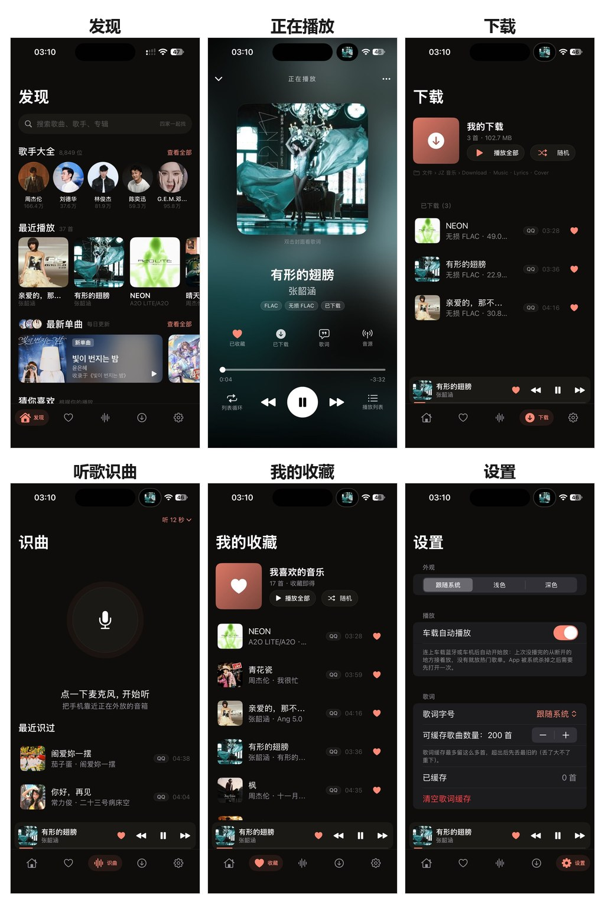

# JZ 音乐助手（JZ Music）

**一个客户端，四家曲库：QQ 音乐、网易云、酷我、酷狗。Windows、Android、iPhone 都能用，不用登录，也没有广告。**

搜一次，四家一起找；这首歌在某家没版权、放不出来，就自动换到有它那家。
歌词逐字跟着唱，iPhone 和 Android 还能「听歌识曲」，iPhone 接上车载蓝牙会自动接着放。
iPhone 版还能**把别家的歌单直接导进来**（QQ 音乐 / 网易云 / 酷我 / 酷狗），发现页会多出「我的歌单」，心动模式也会按它挑歌。

> 想自己编译、看工程结构或发版流程：[docs/ARCHITECTURE.md](docs/ARCHITECTURE.md)、[docs/HANDOFF.md](docs/HANDOFF.md)、[docs/RELEASE.md](docs/RELEASE.md)
> 更新记录：[CHANGELOG.md](CHANGELOG.md)　·　iPhone 新包：[最新发布（v2.4.32）](https://github.com/thewonderfulkey/JZ-private-music-/releases/latest)　·　Windows / Android：[v2.1.95 发布](https://github.com/thewonderfulkey/JZ-private-music-/releases/tag/v2.1.95)

---

## 目录

- [先选你要装哪个](#先选你要装哪个)
- [三个版本共有的能力](#三个版本共有的能力)
- [Windows 桌面版](#windows-桌面版)
- [Android 版](#android-版)
- [iPhone 版（iOS 17+）](#iphone-版ios-17)
- [常见问题](#常见问题)
- [关于音乐来源与版权](#关于音乐来源与版权)

---

## 先选你要装哪个

| 平台 | 系统要求 | 安装包 | 体积 | 装法 |
|---|---|---|---|---|
| **Windows** | Windows 10 / 11（64 位） | `JZ-Music-v2.1.95-windows-x64.exe` | 约 139 MB | 免安装单文件，双击即用 |
| **Android** | Android 8.0 及以上 | `JZ-Music-v2.4.23.apk` | 约 29 MB | 覆盖安装即可 |
| **iPhone** | iOS 17.0 及以上 | `JZ-Music-v2.4.32-4b194cd-r137-ios-unsigned.ipa` | 约 2.5 MB | **未签名**，需自己签一次（Sideloadly / AltStore） |

> 本期 2.4.32 只发了 iPhone 包（Windows / Android 这一轮没有改动，仍是 2.1.95 / 2.4.23，
> 安装包在 [v2.1.95 发布](https://github.com/thewonderfulkey/JZ-private-music-/releases/tag/v2.1.95) 里）。

三个平台共用同一套「搜索 → 换源 → 取流 → 歌词」逻辑，所以同一首歌在哪一端都能放；
差别在**界面版式**和**各平台特性**（下面分开写）。

**一句话选择建议**：桌面上听、要桌面歌词和托盘常驻 → Windows；手机随身、要识曲和悬浮歌词 → Android；
iPhone 用户、要"上车就响"和干干净净的设置页 → iOS。

---

## 三个版本共有的能力

| 能力 | 说明 |
|---|---|
| **四家一起搜** | 一个搜索框同时搜 QQ 音乐 / 网易云 / 酷我 / 酷狗，结果按可信度排好，并标出各家各有多少条 |
| **放不出来就换家** | 当前平台没音源时，自动用别家的同一首歌补上；仍失败会按 2s / 2.5s / 3s 重试，连续 3 首没源才停下并给一句人话 |
| **逐字歌词** | 词里有毫秒级逐字时间（酷狗 KRC / QQ QRC）就一个字一个字亮，只有行级 LRC 就整行高亮 |
| **三档音质** | 标准 128k / 高品 320k / 无损 FLAC；标称与实际不符会按文件头 + 体积反过来校验，避免"标着无损其实是 320k" |
| **下载** | 下载管理、进度、删除；能同时保存歌词与封面，离线也有词有图 |
| **收藏 / 最近播放 / 搜索历史** | 收藏即得；最近播放与搜索历史可一键清空 |
| **不登录、无广告、无会员墙** | 打开就能用，没有任何账号体系 |
| **水墨纸墨风格** | 从按钮到边角都是同一套纸墨设计，不是给系统控件换个颜色 |

**各端差异（重要）**

| 能力 | Windows | Android | iPhone |
|---|---|---|---|
| 听歌识曲 | ❌ 没有麦克风链路 | ✅ | ✅ |
| 悬浮 / 桌面歌词 | ✅ 桌面歌词窗 | ✅ 桌面歌词悬浮窗 | ❌（只有系统锁屏播放卡片） |
| 车载蓝牙自动播放 | ❌ | ❌ | ✅ |
| 下载位置可改 | ✅ 设置里选目录 | ❌ 固定进系统音乐库 | ✅ 可在「文件」里换文件夹 |
| 歌词偏移微调 | ❌ | ❌ | ✅ 按单曲微调 |

---

## Windows 桌面版

### 这个版本的样子

不是手机版拉宽，是按电脑客户端的习惯重排的：**左侧栏导航 + 中间内容区 + 右侧正在播放与歌词 + 底部播放条**。
窗口可缩放，内容区最宽 700pt、居中显示，不会在大屏上拉成一条。

### 特色

- **桌面歌词窗**：独立浮窗，置顶显示、可拖动、三种纸色（素纸 / 旧黄 / 夜墨）、五档字号、可锁定位置；
  点一下浮出工具条（上一句 / 暂停 / 下一句 / 字号 / 锁定 / 关闭），3 秒不操作自动收起。
  长句自动缩字号或折行，不会出现省略号。
- **托盘常驻 + 单实例**：窗口收起来后继续放歌，托盘图标右键可控制；再次双击程序不会开第二个窗口，而是把原窗口唤回来。
- **边放边缓存**：正在播的这首会同时落盘，拖动进度条不用再等重新取流；切歌或播完自动释放。
- **真正的桌面程序**：Compose Desktop + FFmpeg 解码，不是 Electron / WebView 套壳；滚动、拖动、悬浮反馈都是原生的手感。
- **没有听歌识曲**：桌面端没有麦克风采集链路，识曲请在手机端用。这是刻意不做的，不是坏了。

### 安装

1. 下载 `JZ-Music-v2.1.95-windows-x64.exe`，放到一个**固定目录**（例如 `D:\JZ Music\`）。
2. 双击运行。首次启动会把程序解开到 `%LOCALAPPDATA%\JZ Music\app-2.1.95\`，之后启动就很快了。
3. 程序**没有数字签名**，Windows 会提示「Windows 已保护你的电脑」：
   点 **更多信息 → 仍要运行** 即可。杀毒软件也可能报未知程序，加白名单即可。
4. 升级：直接拿新的 exe 覆盖旧的，`Data` 与下载的音乐不受影响。
5. 卸载：删掉 exe、`%LOCALAPPDATA%\JZ Music\` 和安装目录里的 `Download` / `Cache` / `Data` / `Backup`。

### 注意

- 音乐**默认下载到程序所在目录的 `Download\`**，设置页里能改；`Cache\` 是播放缓存，可随时清空。
- 首次启动会建 `Download / Log / Cache / Data / Backup` 五个目录，`Data` 里是收藏、历史、设置，删了等于重置。
- 电脑上如果开了公司代理 / 防火墙，个别音源接口会被挡，表现为"某些歌没源"，换个网络再试。
- 播放链路依赖 FFmpeg 解码，无损 FLAC、m4a、mp3 都能放；极少数非常规容器会退回 320k。

---

## Android 版

> 取自 Android 模拟器（Pixel 5，1080×2340）实跑：搜索「晴天」时四家分别返回 50 / 50 / 32 / 30 条；
> 播放页底部那行是实际音源（cyapi QQ · 标准 128k · m4a · ID 直连）。

### 特色

- **听歌识曲**：录 12 / 15 / 20 秒（设置里可选），走酷狗指纹 + 网易 afp 双通道，两家候选统一打分，
  再按「是否原唱、歌名是否干净、是否正式专辑、时长是否吻合、双通道是否互证」给出结论，并**写出判断依据**。
  识别前会自动暂停本机播放（不暂停录到的就是自己放的歌）。
- **桌面歌词悬浮窗**：退到桌面或切到别的应用时，屏幕底部浮一栏跟着唱的歌词；
  拖动可调位置，松手自动留边距；点一下浮出工具条（上一句 / 暂停 / 下一句 / 字号 / 锁定 / 关闭）。
  需要系统「显示在其他应用上层」权限，设置页里有**一键去授权**。
- **后台连播**：前台服务 + 通知栏控制，息屏、切应用后一首播完会继续下一首。
  建议在设置页把「电池优化」设成**不限制**，否则锁屏久了系统会掐网络，下一首取不到流。
- **下载进系统音乐库**：`Music / JZ音乐助手`，在「音乐」或「文件」App 里能看到，也能被其它播放器导入。
- **水墨单主题**：整个 App 只有一套纸墨设计，不做多主题切换。

### 安装

1. 下载 `JZ-Music-v2.4.23.apk`。
2. 点开安装；系统会提示"未知来源"，允许本文件安装即可（Android 8.0 及以上）。
3. 首次启动按提示给权限：**通知**（下载完成提示、通知栏控制）、**麦克风**（识曲）、**悬浮窗**（桌面歌词，可后续再给）。
4. 升级直接覆盖安装，收藏与下载不会丢（签名与历次版本一致，**不要装其它渠道改签过的包**）。

### 注意

- 下载目录固定为系统媒体库，**不能在 App 内改**（这是 Android 存储权限的正常做法）。
- 首次启动会申请"忽略电池优化"，拒绝也不影响前台使用，但锁屏连播建议允许。
- 识曲必须外放声音；戴耳机识别不到（录到的是耳机里的静音）。
- 部分机型（尤其国产 ROM）会额外杀后台，需要到系统设置里给本应用"允许后台运行 / 自启动"。

---

## iPhone 版（iOS 17+）

> iPhone 真机截图（iOS 17，v2.4.17 时截的）：下载页已按 `Download › Music / Lyrics / Cover` 分目录；
> 设置页只剩外观 / 车载自动播放 / 歌词字号 / 可缓存歌曲数量 / 识曲 / 下载 / 数据 / 关于。

### 特色

- **五个页签**：发现 / 我的收藏 / 识曲 / 下载 / 设置。发现页有歌单广场、歌手大全、最新单曲、热门与猜你喜欢。
- **导入歌单 →「我的歌单」**（2.4.28 起，详见下节）：把 QQ 音乐 / 网易云 / 酷我 / 酷狗的分享链接粘进来，
  歌单整份存到本机；发现页会多出一排「我的歌单」，点进去就是完整曲目，心动模式也会按这些歌单挑歌。
  没导入过歌单时，发现页和以前一模一样（最近播放下面直接就是最新单曲）。
- **猜你喜欢只在有播放记录后出现**（2.4.30 起）：纯新用户不再看到这个模块，听完第一首它自己长出来。
- **上车就响**：连上**车载蓝牙或车机**后自动开始放——上次没播完的从断开的地方接着放；上次没放歌就放热门。
  这里是"连上蓝牙自动播"的行为，**不是 CarPlay 车机界面**（那需要 Apple 单独审批的权限，见下）。
- **逐字歌词**：词里带毫秒级逐字时间就逐字染色，只有行级时间就整行；播放页的「慢一点 / 快一点」按**单曲**微调，
  不会把别的歌一起推歪。
- **下载分三个文件夹**：`文件 › JZ 音乐 › Download › Music`（歌曲）、`… › Lyrics`（歌词）、`… › Cover`（封面），
  在「文件」App 里一目了然；保存位置可以在 App 内换到别的文件夹，旧目录里的文件启动时自动搬过去。
- **系统级集成**：锁屏 / 控制中心 / 耳机双击都能控制；主屏小组件「今日精选」；
  三个快捷指令（**播放我的收藏**、**听歌识曲**、**搜索歌曲**）。
- **设置页只留必要项**：音质恒从无损起取（拿不到自动降档）、无源自动换源 / 跨平台补源 / 自动跳过恒开、
  连续跳过 3 首就停、识别前一定暂停本机播放；能改的是外观、歌词字号、可缓存歌曲数量、识曲时长、下载选项与保存位置。

### 导入歌单（2.4.28 起）

iPhone 版可以直接把别家的歌单搬进来，不用一首首加收藏。

**怎么用**

1. 在 QQ 音乐 / 网易云 / 酷我 / 酷狗里打开歌单 → 分享 → 复制链接（整段分享文案也行，链接前后的文字会自动忽略）。
2. 本 App：**设置 → 歌单 → 导入歌单** → 粘贴 → 「导入」。几百首的大歌单要十几秒，页面有进度提示。
3. 回到发现页，「最近播放」下面会多出「**我的歌单**」：横滑卡片，点一张进详情页（页头 + 播放全部 + 全部曲目）；
   右上角「查看全部」可以管理已导入的歌单（长按删除）。

**歌单更新了怎么办**

重新导入**同一条链接**即可：同一个歌单会**替换成新快照**，不会多出一张同名歌单。

**它是快照**

导入那一刻把歌名、歌手、专辑、时长、封面、平台歌曲 id 全存到本机，之后打开、播放都不再联网取歌单——
所以不会"越用越慢"，也不会因为平台改接口就突然变空。想更新就重新导一次。

**心动模式也会用它**

导入的歌单会算进心动模式的口味权重（下载 > 收藏 > **导入歌单** > 搜索 > 播放）：
新歌按歌单里的歌手去找，旧爱位会直接放歌单里的歌，理由条写「来自你导入的《歌单名》」。
只导了几张歌单、没有其他播放记录的用户，也能直接跑心动模式。

**边界（先说明白）**

- 只支持**公开歌单**：私密歌单、别人「我喜欢的音乐」需要登录态，读不到——会明确提示，不会假装成功。
- 网易云单张歌单**最多导前 1000 首**（接口上限）；QQ / 酷我 / 酷狗同样按 1000 首封顶。
- 酷狗新版 `gcid_xxx` 链接与老版数字链接指向同一歌单时，会被当成两条（同一种链接重复导入仍是替换）。
- 导入只负责"把歌列出来"；真正播放仍走四平台取流，VIP 独占曲目可能没源——和普通搜索播放一致。

### 安装（未签名包，需要自签）

Apple 不会替第三方自签，这是**未签名 IPA**，要用自己的 Apple ID 签一次：

1. 电脑上装 [Sideloadly](https://sideloadly.io/)（Windows 即可）或 [AltStore](https://altstore.io/)。
2. 手机连电脑，把 IPA 拖进 Sideloadly，填自己的 Apple ID，点开始；按提示在手机上信任证书。
3. 或者用 AltStore：在手机上安装 AltStore，用同一账号登录后从「My Apps」里装 IPA。
4. 首次打开若提示「不受信任的开发者」：**设置 → 通用 → VPN与设备管理 → 开发者 App → 信任**。
5. 个人签名 **7 天有效**，到期要重签；AltStore 可以自动续签（同一 Wi-Fi 下每天刷新一次）。

不需要越狱，也不需要付费开发者账号（普通 Apple ID 就够，最多同时签 3 个 App）。

### 注意

- **不做 CarPlay 车机界面**：车机屏上出现本 App 需要 Apple 单独审批的 `com.apple.developer.carplay-audio` 权限，
  自签分发包拿不到。能做的"连车载蓝牙自动接着播"已经做了。
- **App 被系统杀掉之后**，连上车机不会自动响，需要先打开一次 App（iOS 不允许为蓝牙事件冷启动进程）。
- 下载目录：`文件 › JZ 音乐 › Download › Music / Lyrics / Cover`；换保存位置只影响**之后**的下载，已下好的不动。
- 识曲需要麦克风权限，识别前会自动暂停本机播放；环境太吵或只用耳机听会识别不到。
- 没有悬浮歌词（iOS 不允许跨 App 浮窗），歌词在播放页内显示，锁屏是系统自带的播放卡片。

---

## 常见问题

**Q：点了某首歌，提示"没有可用的播放源"？**
A：程序已经自动换过平台、并按 2s / 2.5s / 3s 重试过 3 轮。还是不行就说明四家都拿不到（付费、独家、下架或接口临时抽风），
换关键词（加歌手名）或过一会儿再试；连续 3 首都这样就会停下来，不会一路跳空。

**Q：为什么有的歌只有 320k，没有无损？**
A：无损是否有货取决于平台，跟客户端无关。iOS 端会从无损起取、拿不到自动降档；Windows / Android 可在设置里选默认档位。
下载完成后会按文件头 + 体积复核，标称与实际不符会改回来并提示。

**Q：导入歌单失败 / 只导入了一部分？**
A：先看是不是**公开歌单**——私密歌单和别人的「我喜欢的音乐」需要登录，读不到；再确认链接是歌单分享链接
（不是单曲或歌手页）。网易云单张歌单最多导前 1000 首（接口上限）。导入的是**快照**，歌单后来更新了，
重新导入同一条链接就会替换成新内容，不会多出一张同名歌单。

**Q：导入的歌单能同步吗？会自己更新吗？**
A：不会自动更新。导入时把歌整份存在本机，之后不再联网取歌单；想刷新就重新导一次同一条链接（覆盖旧的）。
这个"一次导入、之后离线"是故意的：打开了就有、不会转圈，也不会因为平台改接口突然变空。

**Q：歌词和声音对不上？**
A：iPhone 播放页歌词区有「慢一点 / 快一点 / 归零」，只调当前这一首（按单曲记住），不影响别的歌；
同一个歌名不同版本（Live / 重制）前奏差几秒是正常的。Windows / Android 目前不支持微调。

**Q：Windows 提示"未知发布者"、杀软报毒？**
A：发版没有数字签名（签名证书要钱且需要企业资质）。点「更多信息 → 仍要运行」，杀软里加白名单。
源码完全公开，可以自己编译核对。

**Q：iPhone 装完 7 天后打不开了？**
A：个人签名到期，重签一次即可（AltStore 会自动续）。收藏、下载、设置都在 App 沙盒里，重签覆盖安装不会丢。

**Q：下载的歌在哪？**
A：Windows → 程序目录 `Download\`；Android → 系统媒体库 `Music / JZ音乐助手`；iPhone → `文件 › JZ 音乐 › Download`（歌曲 / 歌词 / 封面三个文件夹）。

**Q：识曲要多久？为什么开始识别前会突然暂停？**
A：一般 6~12 秒出结果；暂停是**故意的**——不暂停，麦克风收到的是自己放的歌，识别结果会变成"识别到自己"。

**Q：会保存我的搜索、收藏到服务器吗？**
A：不会。收藏、最近播放、搜索历史、识曲历史都只存在本机（Windows 在 `Data\`，Android 在应用私有目录，iPhone 在沙盒）。

---

## 关于音乐来源与版权

- 音乐与歌词来自 QQ 音乐 / 网易云 / 酷我 / 酷狗的**公开接口聚合**，仅供个人学习与测试使用；**请支持正版**。
- 本应用**不存储、不传播**任何音频文件，只做检索、试听与本地缓存/下载。
- 曲库版权与接口可用性随时变化，个别歌曲缺少某档音质、或某天突然没源属正常现象。
- 所有数据都在你自己设备上：没有账号体系，不上传录音，也不收集使用行为。

---

## 版本

| 平台 | 当前版本 | 说明 |
|---|---|---|
| Windows | 2.1.95 | 免安装单文件（139 MB），[v2.1.95 发布](https://github.com/thewonderfulkey/JZ-private-music-/releases/tag/v2.1.95) |
| Android | 2.4.23（201） | 覆盖安装，[v2.1.95 发布](https://github.com/thewonderfulkey/JZ-private-music-/releases/tag/v2.1.95) |
| iPhone | **2.4.32（210）** | 未签名 IPA，自签安装，[最新发布](https://github.com/thewonderfulkey/JZ-private-music-/releases/latest) |

2.4.32 这一轮只动了 iPhone（导入歌单 / 我的歌单 / 心动模式吃歌单 / 猜你喜欢显隐 / 歌词取词）；
Windows 与 Android 代码没改，安装包仍是上面那两版。每一轮的改动记在 [CHANGELOG.md](CHANGELOG.md)。
