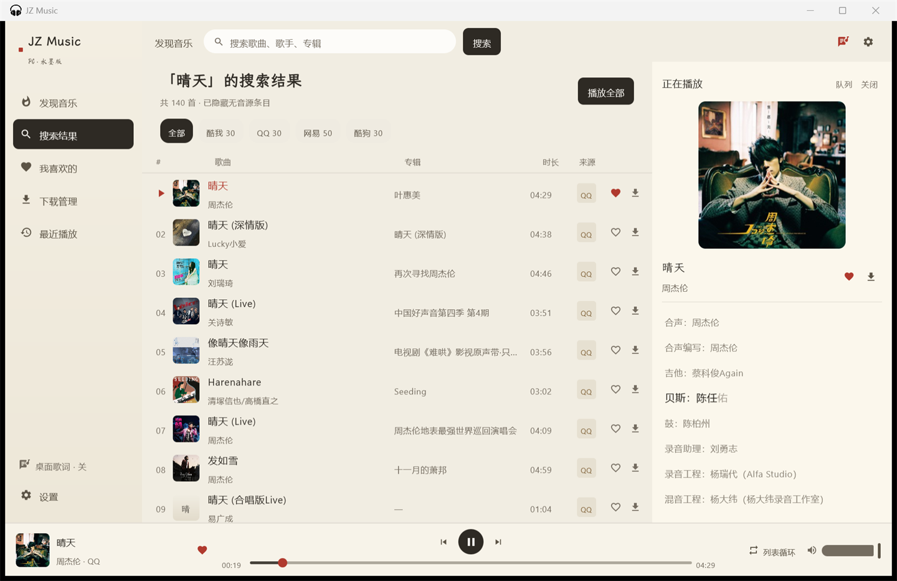

# JZ 音乐助手（JZ Music）

**一个客户端，四家曲库：QQ 音乐、网易云、酷我、酷狗。手机和电脑都能用，不用登录，也没有广告。**

搜一次，四家一起找；这首歌在某家没版权、放不出来，就自动换到有它的那家。歌词逐字跟着唱，
电脑上还能单独浮一条桌面歌词；手机端还能「听歌识曲」。

## 能做什么

| 功能 | 说明 |
|---|---|
| **四家一起搜** | 一个搜索框同时搜 QQ 音乐 / 网易云 / 酷我 / 酷狗，结果按可信度排好，并标出各家各有多少条 |
| **放不出来就换家** | 某首歌在当前平台没有可用音源时，自动用别家的同一首补上，不用你自己去切 |
| **逐字歌词** | 唱到哪个字亮哪个字（毫秒级），手机和电脑一样；电脑上还能把歌词浮在桌面上 |
| **听歌识曲** | 手机端录 10 秒，给出歌名 / 歌手，并尽量判断是原唱还是翻唱，附上判断依据 |
| **下载** | 三档音质（标准 128k / 高品 320k / 无损 FLAC），有下载管理，能删、能改下载目录 |
| **日常** | 收藏、最近播放、搜索历史、一键备份；电脑端可收进托盘，关掉窗口也继续放 |
| **电脑版排版** | 左侧栏导航 + 宽内容区 + 右侧正在播放和歌词 + 底部播放条，按电脑客户端的习惯来 |

## 亮点

- **不用开四个 App**：想听一首歌，搜一次就够，哪家有就放哪家。
- **不打断你**：一首歌放不出来，它自己换源接着放，不会弹个错误让你自己处理。
- **歌词真的逐字**：不是整句一起变色，而是跟着唱到哪个字亮哪个字；电脑上歌词可以浮在桌面最上层。
- **电脑版跟手**：滚动、拖动、悬浮反馈都是原生桌面程序的手感，不是网页包一层；托盘常驻、单实例、关窗继续放。
- **干净**：没有开屏广告、没有登录弹窗、没有会员等级，打开就能用。

## 稀缺（大多数播放器没有的）

- **一个播放器管四家曲库，而且会"跨平台补位"**：官方客户端只搜自家曲库；常见的聚合搜索工具大多只把结果列出来，
  真到播放还是"没源就是没源"。这里在取流阶段就会换到有源的那家。
- **识曲分原唱 / 翻唱，并把依据摆出来**：多数识曲只丢给你"最像的一首"，翻唱、Live、DJ 版混在一起；
  这里会把候选按「是否原唱、歌名是否干净、是否正式专辑、时长是否吻合、两条通道是否互证」打分，再告诉你凭什么是它。
- **电脑版是原生程序，不是网页套壳**：手机和电脑共用同一套取流 / 歌词 / 播放逻辑，电脑端编译成真正的桌面程序
  （Compose Desktop + FFmpeg 解码），不是 Electron 或 WebView 套一层。
- **从界面到边角都是同一套水墨风格**：连托盘右键菜单、桌面歌词条、甚至"更换下载位置"的选文件夹弹窗都是自己画的纸墨样式，
  不是给系统灰控件换个颜色。
- **不用登录、没有会员墙、没有广告位**。

## 做这个难在哪

- **音源是"活"的**：各平台的搜索和取流接口一直在变，直链还有时效；同一首歌往往有原唱、翻唱、Live、DJ 好几个版本。
  所以程序里做了多条取流通道，一条不行换下一条，并且会按文件体积反过来校验音质——避免"标着无损、实际是 128k"。
- **识曲要"听得出原唱"**：把 10 秒录音算成音频指纹，酷狗、网易两条通道各给一批候选，再统一打分比较。
  这一步没有现成方案，是拿真实样本一条条试出来的（比如同一段伴奏的翻唱会被排除）。
- **逐字歌词要自己对齐**：三家给的歌词格式完全不同（普通 LRC、酷狗 KRC、QQ QRC），要把它们对到同一条时间轴上，
  再按毫秒插值染色；手机和电脑用同一份歌词逻辑，画法却要各写一遍。
- **两端做到"像同一个 App"**：手机上用 Canvas 画的水墨效果，电脑上要用 Skia / Java2D 重画；
  桌面端的悬浮歌词窗、托盘菜单、无边框窗口、高清屏缩放都得自己处理系统差异。

## 下载

| 平台 | 文件 | 说明 |
|---|---|---|
| Windows 10 / 11 | `JZ-Music-v2.1.95-windows-x64.exe` | 约 139 MB，免安装单文件，自带运行环境，双击即用 |
| Android 8.0+ | `JZ-Music-v2.1.95.apk` | 约 29 MB，覆盖安装即可 |

全部文件在 [最新发布（Releases）](https://github.com/thewonderfulkey/JZ-private-music-/releases/latest)，源码在同一页的 **Source code**。

- **Windows**：首次启动会把程序解开到 `%LOCALAPPDATA%\JZ Music\app-<版本>`，之后秒开；
  程序没有数字签名，Windows 首次运行会提示「未知发布者」，点「更多信息 → 仍要运行」即可。
- **Android**：签名和历次版本一致，可以直接覆盖安装；请不要装其它渠道改过的包。

## 已知限制

- 只有 Android 和 Windows，没有 iOS / macOS。
- 听歌识曲只有手机端（电脑版没有麦克风链路）。
- 依赖各平台公开接口：哪天对方改接口，某些歌可能暂时没有可用音源；程序会尝试换平台，但不保证一定有。
- 付费 / 独家曲目拿到才有，拿不到就是没有。
- Windows 版没有数字签名；Android 用固定证书签名，所以必须一直用同一个证书，不能换。

## 关于

个人做的音乐播放器，目标很朴素：**一个客户端，听完四家的歌**，界面按自己喜欢的纸墨风格重做。

想自己编译、看工程结构或发版流程，从这里进：[docs/ARCHITECTURE.md](docs/ARCHITECTURE.md)（结构）、
[docs/HANDOFF.md](docs/HANDOFF.md)（接手说明）、[docs/RELEASE.md](docs/RELEASE.md)（构建与发版）。
