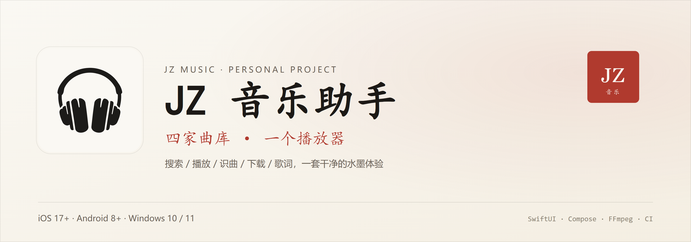
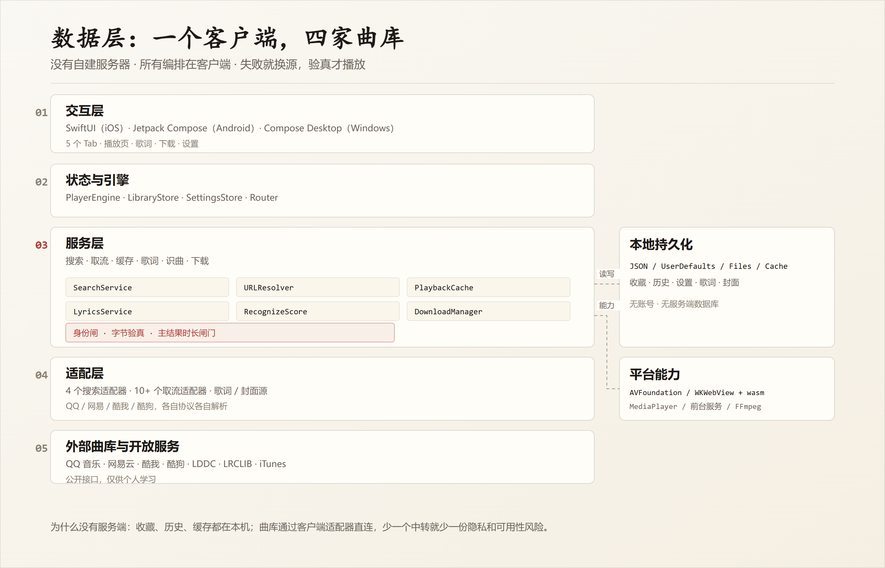
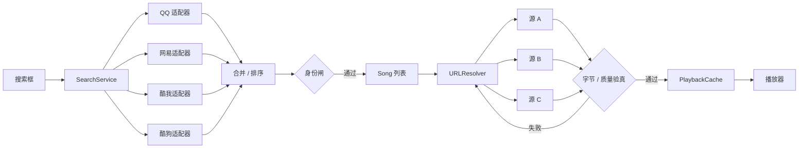
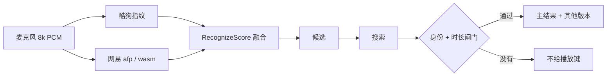
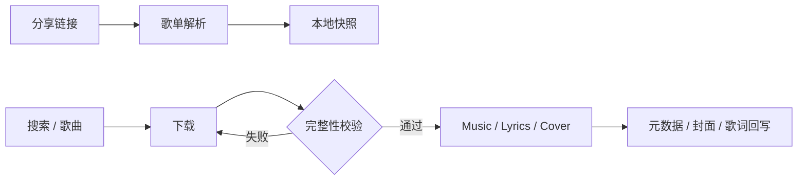
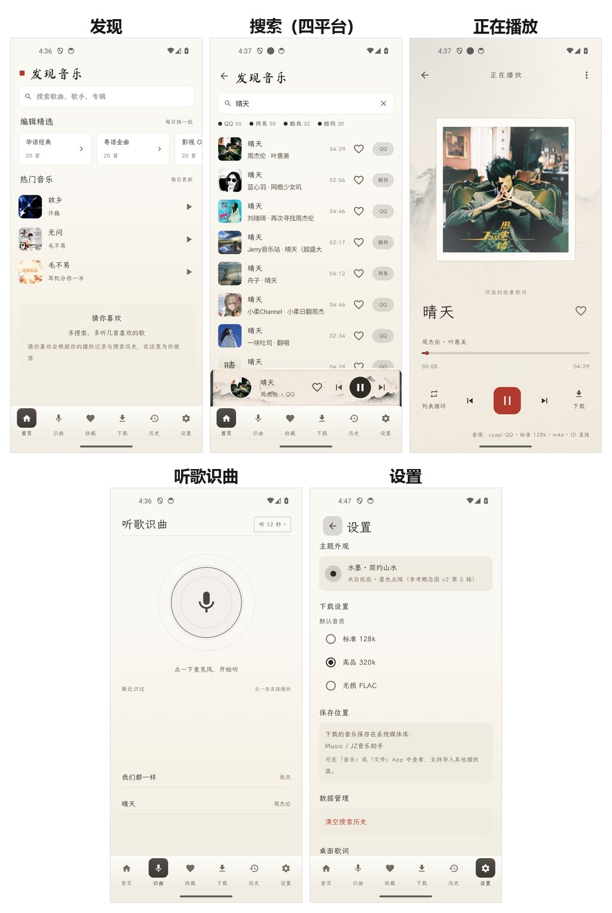
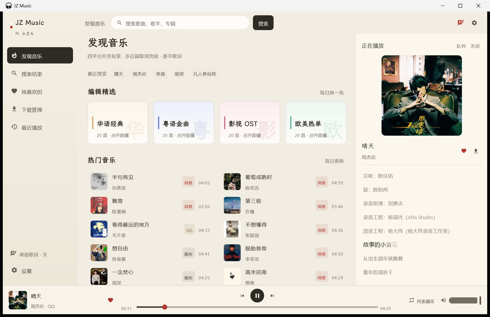

# JZ 音乐助手（JZ Music）

<p align="center">
  <picture>
    <source media="(prefers-color-scheme: dark)" srcset="docs/images/readme/banner-dark.png">
    
  </picture>
</p>

<p align="center">
  <b>一个客户端，四家曲库。</b><br>
  <sub>把 QQ 音乐、网易云、酷我、酷狗的搜索、播放、识曲、下载、歌词，收进一套干净的水墨体验。</sub>
</p>

<p align="center">
  
  
  
  
  
  
</p>

<p align="center">
  <a href="https://github.com/thewonderfulkey/JZ-private-music-/releases/tag/v2.4.140">最新安装包</a> ·
  <a href="#先读这一屏">先读这一屏</a> ·
  <a href="#功能地图">功能地图</a> ·
  <a href="CHANGELOG.md">更新记录</a>
</p>

**3 端** · **4 家曲库** · **550+ commits** · **1,700+ 断言** · **139 个 iOS 包** · **120+ 次版本迭代**


## 先读这一屏

> [!TIP]
> **这是什么**：一个多源音乐客户端。四家曲库一起搜，按同一套身份/质量规则选出真正能播的那一首；iOS 17+ 是主力，Android / Windows 同源跨端。
>
> **为什么难**：四家没有统一 API；元数据各写各的；取流会过期、会回占位音频、会标 320k 实际 128k；客户端要自己走完「搜索 → 身份 → 取流 → 验真 → 缓存 → 播放」。
>
> **最值得看的三件事**：
> 1. **身份闸**：先证明是同一条录音（歌名 / 歌手 / 专辑 / 时长 / 版本），再谈播放。
> 2. **取流验真**：三级取流 + 字节、文件头、码率校验；占位、加密包、假 320k 不进出口。
> 3. **交付闸门**：1,700+ 断言、pbxproj / 界面卫生检查、IPA 二进制身份闸；139 个 iOS 包，不是“构建成功就发”。
>
> **只读三分钟**：看完这一屏，跳到 [架构](#架构) 和 [工程亮点](#工程亮点)；想深挖再看 [模块深挖](#模块深挖) 和 [真实故障复盘](#真实故障复盘)。

这个项目的起点很具体：我在四个平台听歌，但每家的曲库、版权、音质、歌词都不完整；官方客户端也不会把四家放进同一个搜索框。于是我做了一个自己的播放器：一个搜索框、一个播放队列、一套本地库，把四家当成一个用。

它远比一个 CRUD 作业难：要处理四家平台不一致的身份、会失效的直链、标称和实际不符的音质、后台播放的生存问题，以及“用户看到的是不是真的”这件事。

**目录**：[In English](#in-english) · [功能地图](#功能地图) · [架构](#架构) · [数据流](#数据流) · [模块深挖](#模块深挖) · [真实故障复盘](#真实故障复盘) · [工程亮点](#工程亮点) · [技术栈](#技术栈) · [仓库结构](#仓库结构) · [构建与发布](#构建与发布) · [边界与免责声明](#边界与免责声明) · [关于](#关于)


## In English

**JZ Music** is a multi-source music client for iOS, Android, and Windows, built as a personal project and shipped across 120+ iterations.

- **One client, four catalogs.** QQ Music, NetEase Cloud Music, Kuwo, and Kugou are searched concurrently; results are merged, ranked, and identity-checked before playback.
- **A complete player.** Streaming with source failover and byte-level verification, word-by-word lyrics, downloads, playlist import, a local library, and on-device song recognition.
- **On-device by design.** No account, no ads, no owned server; library, history, cache, and settings stay on the device.
- **Built to ship.** SwiftUI + AVFoundation on iOS, Kotlin + Compose on Android and Windows; GitHub Actions runs 1,700+ assertions and an IPA binary identity gate.

**Stack:** Swift · SwiftUI · AVFoundation · WKWebView + WebAssembly · Kotlin · Jetpack Compose · Compose Desktop · FFmpeg · Python · GitHub Actions.


## 功能地图

<p align="center">
  
  <br>
  <sub>iPhone 版界面（v2.4.17 截图；版式沿用，功能已到 2.4.140）。</sub>
</p>

| 模块 | iOS | Android | Windows | 关键点 |
|---|:--:|:--:|:--:|---|
| 发现 / 多源搜索 | ✅ | ✅ | ✅ | 四家并发、合并排序、身份闸、垃圾/版本过滤 |
| 播放 / 队列 / 模式 | ✅ | ✅ | ✅ | iOS 心动模式；后台连播、失败切源、进度/时长真值 |
| 歌词 / 逐字 / 翻译 | ✅ | ✅ | ✅ | KRC / QRC / LRC；iOS 单曲偏移 |
| 识曲 | ✅ | ✅ | — | 酷狗 + 网易双通道；主结果时长闸门 |
| 下载 / 缓存 / 回写 | ✅ | ✅ | ✅ | 多源、完整性、Music / Lyrics / Cover |
| 收藏 / 最近 / 历史 | ✅ | ✅ | ✅ | 本机存储、跨平台去重 |
| 歌单导入 / 我的歌单 | ✅ | — | — | 四家分享链接；本地快照 |
| 心动模式 | ✅ | — | — | 五路信号；每首给推荐理由 |
| 本地导入 / 标签写回 | ✅ | — | — | 导入文件、元数据/封面/歌词回写 |
| 系统集成 | ✅ | ✅ | ✅ | Widget/Intents/锁屏/车载；前台服务/悬浮词；托盘/桌面歌词 |
| 设置 / 存储 / 自检 | ✅ | ✅ | ✅ | 缓存上限、存储审计、数据清理 |
| 设计系统 | ✅ | ✅ | ✅ | 纸墨朱砂；iOS 语义字体、Android 文楷 |
| 跨端同构 | ✅ | ✅ | ✅ | 同一套领域模型/算法，界面各自原生 |

> [!NOTE]
> **iOS 是当前主力**：`2.4.140 / 318`，CI #321。Android / Windows 最新包是 `2.4.35`，部分 iOS 专属能力（心动模式、歌单导入、本地标签写回）没有回移；差异以这张表为准，不把三端写成一样。


## 架构

<p align="center">
  
</p>

从上到下是五层：**界面 → 状态/引擎 → 服务 → 适配器 → 外部曲库**；右侧是**本地持久化**和**平台能力**。

分层是表象；真正决定质量的是**约束放在哪一层**：

- **身份/质量规则只写一次**：`NameMatch` / `StudioPick` / `PlaybackQualityRules` 在服务层被搜索、识曲、下载、播放复用；不让每个适配器各写一套“像不像”。
- **平台差异关在适配器里**：四家搜索、10+ 个取流后端、歌词/封面源，各自协议各自解析；新增一家 = 新增一个适配器 + 注册一行。
- **播放器只接受结果**：`PlayerEngine` 拿到的是“验真过的 Song + 可播的字节流”，不关心 URL 从哪来、是哪家给的。

### 没有自建服务器，是刻意的

收藏、最近播放、搜索历史、识曲历史、设置、缓存都在本机；没有账号、没有上传、没有服务端数据库。代价是客户端要承担全部编排和校验，好处是：

- **离线可用**：本地库、缓存、下载不依赖远端；
- **隐私边界清楚**：不上传行为，不需要登录；
- **没有单点**：少一个中转，就少一份“服务挂了全挂”的风险。

更细的逐模块设计：iOS 见 [docs/ios/](docs/ios/)，Kotlin 端见 [docs/ARCHITECTURE.md](docs/ARCHITECTURE.md)。

## 数据流

### 1. 搜索 → 取流 → 播放



四家并发不是简单 merge：先按歌名 / 歌手 / 专辑 / 时长做身份归并，再按质量分排序；取流分三级，失败回退；验真不过就换源；连续 3 首无源才停，并把原因说成人话。

### 2. 识曲 → 双通道 → 主结果



麦克风采 8k 单声道 PCM；酷狗收裸 PCM，网易要 afp 指纹（在 `WKWebView` 里跑 wasm）。两路候选统一打分；候选再走搜索，主结果还要过“歌名 / 歌手 / 时长”闸门：识别对不等于选中对。

### 3. 导入 / 下载 / 回写



歌单导入是快照：导入那一刻把歌名、歌手、专辑、时长、封面、平台 id 全存到本机，之后打开不再联网取歌单。下载走多源，完整性校验后落到 `Music / Lyrics / Cover` 三个目录；标签、封面、歌词再写回文件与旁车。


## 模块深挖

> 每个模块都按“解决什么 / 怎么做 / 边界与取舍”写；代码链接直接落到文件。

### 6.1 发现与搜索：四家一起搜，再证明是同一条

- **解决什么**：一个搜索框要同时问四家；四家的歌名、歌手、专辑、时长写法都不一样，直接 `first` 会播错歌。
- **怎么做**：四个适配器并发；`SearchService` 合并、去重、按质量分排序；`NameMatch` / `StudioPick` 做身份归并；垃圾音频（变速版、DJ 版、剪辑版）在出口过滤；发现页的榜单/歌手/歌单广场按天缓存。
- **边界**：搜索不是“全库”，是“平台愿意返回的前 N 条”；私密歌单、登录态内容读不到；接口没有 SLA。
- **代码**：[SearchService.swift](ios/JZMusicHelper/Services/SearchService.swift) · [SearchAdapters.swift](ios/JZMusicHelper/Services/SearchAdapters.swift) · [SearchRanker.swift](ios/JZMusicHelper/Services/SearchRanker.swift) · [NameMatch.swift](ios/JZMusicHelper/Services/NameMatch.swift)

### 6.2 播放引擎：队列、四种模式、后台连播

- **解决什么**：播完不换歌、切后台被系统挂起、失败切源卡住、进度和总时长对不上。
- **怎么做**：`PlayerEngine` 管队列/当前曲/四种模式；后台音频会话 + `NowPlayingCenter` 接锁屏/控制中心；下一首预取；起播失败按源回退；时长用实测校准，不信接口自报。
- **边界**：iOS 后台能力受系统限制；连续 3 首无源会停；CarPlay 车机界面拿不到 Apple 审批权限，只做“连车载蓝牙自动播”。
- **代码**：[AudioPlayer.swift](ios/JZMusicHelper/Services/AudioPlayer.swift) · [NowPlayingCenter.swift](ios/JZMusicHelper/Services/NowPlayingCenter.swift) · [PlaybackRules.swift](ios/JZMusicHelper/Services/PlaybackRules.swift)

### 6.3 取流与验真：三级取流，两道验真

- **解决什么**：同一首歌有多家源；URL 会过期；接口会回占位提示音、加密包、标 320k 实际 128k 的文件。
- **怎么做**：`URLResolver` 三级取流 → 10+ 个 `SourceAdapters` → 字节/文件头/码率验真；`.mgg` / `O4M-O8M` 加密包、181,521 B 占位文件、HTML 假 200 全部拦下；失败按 2 / 2.5 / 3s 重试并熔断冷却。
- **边界**：上游随时失效；无损是否可用取决于平台；极少数歌四家都没有源，会明确说“没有可用的播放源”，不装死。
- **代码**：[URLResolver.swift](ios/JZMusicHelper/Services/URLResolver.swift) · [SourceAdapters.swift](ios/JZMusicHelper/Services/SourceAdapters.swift) · [PlaybackRules.swift](ios/JZMusicHelper/Services/PlaybackRules.swift)

### 6.4 播放缓存：把“每次重新取流”变成“一次取流”

- **解决什么**：每次切歌都重新请求、拖进度条重新取流；缓存错歌比不缓存更糟。
- **怎么做**：当前曲整首落盘 + 下一首预取；LRU 上限；缓存条目带身份（歌名/歌手/时长），复用时再核一次；只缓存“验真通过”的字节。
- **边界**：缓存有上限；身份对不上宁可丢弃；不缓存最终 URL（会过期）。
- **代码**：[PlaybackCache.swift](ios/JZMusicHelper/Services/PlaybackCache.swift) · [PlaybackCacheRules.swift](ios/JZMusicHelper/Services/PlaybackCacheRules.swift)

### 6.5 下载与回写：文件、封面、歌词、标签对齐

- **解决什么**：下载要后台、要断点、要完整；下载完的封面/歌词/标签要和前端编辑一致。
- **怎么做**：后台 `URLSession` + 多源 + 完整性校验（体积/文件头/哈希）；落盘 `Download/Music`、`Lyrics`、`Cover`；元数据、封面、歌词写回音频标签与旁车；重复文件按身份去重。
- **边界**：iOS 后台会话受系统调度；文件保护/备份默认关；写回能力取决于容器格式。
- **代码**：[DownloadManager.swift](ios/JZMusicHelper/Services/DownloadManager.swift) · [MetadataWriter.swift](ios/JZMusicHelper/Services/MetadataWriter.swift) · [AudioTagEmbedder.swift](ios/JZMusicHelper/Services/AudioTagEmbedder.swift)

### 6.6 歌词：先准，再全

- **解决什么**：四家歌词格式不同；逐字、翻译、繁简、偏移都要对；不能拿错歌的词。
- **怎么做**：`LyricsService` 单一入口，4h 缓存 + in-flight 去重；KRC / QRC / LRC 解析，逐字染色；翻译、繁转简；平台 id 优先取官方词，拿不到再走酷狗逐字词 / LRCLIB；单曲偏移记忆。
- **边界**：逐字只有部分平台给；歌词源缺失/错配时宁可显示“暂无歌词”；偏移只影响当前这首。
- **代码**：[LyricsService.swift](ios/JZMusicHelper/Services/LyricsService.swift) · [LddcLyrics.swift](ios/JZMusicHelper/Services/LddcLyrics.swift) · [LyricsModel.swift](ios/JZMusicHelper/Services/LyricsModel.swift)

### 6.7 识曲：双通道，最后还要过时长闸

- **解决什么**：听环境/本机外放；一条通道会把翻唱、综艺版认成原唱；识别对了，主结果还可能选错。
- **怎么做**：8k 单声道采集；酷狗裸 PCM + 网易 afp（`WKWebView` + wasm）双通道；`RecognizeScore` 按原唱标记/裸名/专辑/时长/位次/跨通道互证打分；6 秒先问酷狗，没中再录满；主结果再加时长闸门（±5s）。
- **边界**：麦克风听空气：戴耳机、环境吵、音量小都会掉识别率；版权保护/DRM 音频录不到；不是真内录。
- **代码**：[AudioCapture.swift](ios/JZMusicHelper/Services/AudioCapture.swift) · [KugouRecognizer.swift](ios/JZMusicHelper/Services/KugouRecognizer.swift) · [NeteaseFingerprint.swift](ios/JZMusicHelper/Services/NeteaseFingerprint.swift) · [RecognizeScore.swift](ios/JZMusicHelper/Services/RecognizeScore.swift) · [RecognizeResolveRules.swift](ios/JZMusicHelper/Services/RecognizeResolveRules.swift)

### 6.8 歌单导入：一次导入，之后离线

- **解决什么**：换平台听歌，歌单要一首首加收藏；平台链接格式还各不相同。
- **怎么做**：QQ / 网易 / 酷我 / 酷狗四家分享链接解析；整份歌单存成本地快照；同一链接重复导入 = 替换；发现页长出一排「我的歌单」；心动模式也会吃这些歌单。
- **边界**：只支持公开歌单；单张最多 1000 首；不自动同步；VIP 独占曲可能没源。
- **代码**：[PlaylistImport.swift](ios/JZMusicHelper/Services/PlaylistImport.swift) · [MyPlaylistStore.swift](ios/JZMusicHelper/Models/MyPlaylistStore.swift)

### 6.9 心动模式：五路信号，给一个理由

- **解决什么**：不想自己选歌；随机播放又太随机。
- **怎么做**：下载 / 收藏 / 导入歌单 / 搜索 / 播放五路信号合成口味画像；熟悉度滑杆控制新旧比例；“不感兴趣”降权；每首给推荐理由；冷启动走热歌榜。
- **边界**：只用本机信号；推荐来自公开曲库，不保证每首都合口味；连续 3 首无源会停。
- **代码**：[HeartbeatEngine.swift](ios/JZMusicHelper/Services/HeartbeatEngine.swift) · [HeartbeatRules.swift](ios/JZMusicHelper/Services/HeartbeatRules.swift)

### 6.10 本地音乐库：文件、元数据、时长真值

- **解决什么**：本地导入的文件标签乱、封面缺、时长不准；和在线歌曲混在一起会重复。
- **怎么做**：文件导入 + 元数据匹配/写回 + 封面旁车 + 歌词补全；时长用真实音频校准；同一条录音去重；旧数据迁移保留。
- **边界**：容器/编码支持有限；写回失败会保留原文件；iCloud 备份默认关。
- **代码**：[MetadataMatcher.swift](ios/JZMusicHelper/Services/MetadataMatcher.swift) · [LibraryStore.swift](ios/JZMusicHelper/Models/LibraryStore.swift)

### 6.11 设置、存储与数据自检

- **解决什么**：缓存越用越大、下载文件和记录对不上、用户不知道空间去哪了。
- **怎么做**：缓存上限可调；存储审计按目录/类型统计；孤儿文件、重复文件、失效记录可清理；设置项只留真正影响行为的。
- **边界**：所有数据在本机，卸载即丢；自签过期要重签，数据不丢。
- **代码**：[SettingsStore.swift](ios/JZMusicHelper/Models/SettingsStore.swift) · [StorageAudit.swift](ios/JZMusicHelper/Services/StorageAudit.swift)

### 6.12 系统面与跨端：三端不是三套

- **解决什么**：iOS 要锁屏/小组件/快捷指令；Android 要前台服务/悬浮歌词；Windows 要托盘/桌面歌词；三端又不能各写一套业务。
- **怎么做**：iOS 用 WidgetKit / App Intents / `NowPlayingCenter`；Android 用前台服务 + Doze 兜底 + Canvas 悬浮窗；Windows 用 Compose Desktop + JavaCV/FFmpeg；搜索/身份/歌词/识曲等纯逻辑按同一口径移植，界面各自原生。
- **边界**：不做 CarPlay 车机界面；Android 国产 ROM 会杀后台；Windows 包没有数字签名。
- **代码**：[NowPlayingCenter.swift](ios/JZMusicHelper/Services/NowPlayingCenter.swift) · [PlayerService.kt](android/app/src/main/java/com/jz/musichelper/data/PlayerService.kt) · [DesktopLyrics.kt](android/app/src/main/java/com/jz/musichelper/data/DesktopLyrics.kt) · [desktop/](desktop/)

| Android | Windows |
|---|---|
|  |  |

### 6.13 设计系统：纸、墨、朱砂

- **解决什么**：功能一多，界面容易变成系统控件的拼盘；三端视觉要像同一个产品。
- **怎么做**：纸 `#FAF8F3` / 墨 `#1C1916` / 朱砂 `#B03A2E`（暗色反相）；字号只用语义角色；动效有统一令牌（按压、行高亮、舞台三拍）；Reduce Motion / Dynamic Type / VoiceOver 全流程；`check_ui_hygiene.py` 守住 39 个界面文件。
- **边界**：只做一套水墨主题，不做多主题；iOS 用系统语义字体，Android 用霞鹜文楷 / 马善政。
- **代码**：[Tokens.swift](ios/JZMusicHelper/Views/Tokens.swift) · [RecognizeMotion.swift](ios/JZMusicHelper/Services/RecognizeMotion.swift) · [IOS-IA-SCREENS.md](docs/ios/IOS-IA-SCREENS.md)


## 真实故障复盘

这四次故障，根子都是**少了一道闸**（或一段被错误歌手收窄的搜索范围），不是某一行写错。现在它们都变成了机器会检查的东西。

### 7.1 v2.4.39 · 空包：版本号对了，代码没进包

| | |
|---|---|
| **现象** | 群里收到 r146 / r147 两个包，版本号正确，装上去行为和上一版一模一样。 |
| **根因** | 三个 commit 对 `ios/` 的改动分别是空、只改 `project.pbxproj` 版本号、空；583 行修复还躺在工作区。`BUILD SUCCEEDED` + 包内版本正确 = 一路绿灯。 |
| **修法** | 出包三闸：① `git status --short -- ios/` 必须空；② `git show --stat <sha> -- ios/` 必须非空；③ 包内主二进制 sha256 必须与历史包不同（CI 内置 `check_ipa_identity.py`）。 |
| **后来怎么防** | 三道闸写进 `ios-ipa.yml`；「包没变」从人的记忆变成机器会红。后来每次出包都先过这三条。 |

### 7.2 v2.4.117 · 《众》放成《侧脸》：同歌手不等于同一首

| | |
|---|---|
| **现象** | 点《众》，播放器却放《侧脸》；两首同歌手，时长只差 2.3 秒。 |
| **根因** | 身份闸只看「歌手 + 时长 ≤4s」，歌名不否决；320k 的错歌排在 98kbps 的对歌前面；整首还落进了本歌的缓存条目（只记 songID）。 |
| **修法** | 歌名证据改成硬条件；外文译名走「专辑 + ≤1s」；身份排在音质前；缓存带身份复核；时长闸 ±1.5s。 |
| **后来怎么防** | `NameMatch.titleEvidence` / `identityRank` / `cacheIdentityOK` 写进断言；「宁可不对，不可错歌」成为默认口径。 |

### 7.3 v2.4.139 · 《夜曲》被 1:48 剪辑顶掉：识别对 ≠ 选中对

| | |
|---|---|
| **现象** | 结果卡是《夜曲》226s，播放器放《夜曲 - A35》1:48；封面空，识曲历史也记成剪辑。 |
| **根因** | `resolveVersions` 只看歌名/歌手/裸名，`songs.first` 取了搜索列表第一条；`isCleanTitle("夜曲 - A35")` 还返回 true（“A35”不在版本词表里）；真正的 3:46 就在同一列表，甚至被「其他版本」标成原唱。 |
| **修法** | 新增 `RecognizeResolveRules`：候选与结果时长差 ≤5s；通过的选最接近；没有就退「其他版本」原唱，再没有不给播放键。封面/历史跟着正确主结果走。 |
| **后来怎么防** | 5 条 CI 断言 + 本地 mini；主结果和「其他版本」共用同一套时长证据。 |


### 7.4 v2.4.140 · 识别对了却播不了：翻唱候选与“不播错”的代价

| | |
|---|---|
| **现象** | 《5:20AM》：卡面是 `5:20AM(活凤版)/礼崩乐不坏/193s`，点播放却变成 `5:20AM(河南话原版)/夜晚助眠屋/3:11`；《潮汐》：卡面歌手是翻唱 `小青芽`，原唱 `安苏羽、傅梦彤` 找不到。 |
| **根因** | ① 指纹候选本身是翻唱，搜索又用「歌名 + 候选歌手」收窄，原唱进不来；② `RecognizeResolveRules.pick` 的 `titleOnly` 第一支 `normTitle` 相等就放行，没要求歌手——两首去掉括号都是 `520am`，193 vs 191 只差 2s，另一个翻唱过闸；卡面显示候选、播放/封面用 `resolved`。 |
| **修法** | `titleOnly` 两个分支都要求 `singerMatches`；没有同歌手版本就 `resolved = nil`，不给播放键；卡面统一显示 `resolved`，候选只进「识别依据」；加「翻唱/版本」标签；核心歌名 title-only 搜索把原唱放进「其他版本」（6→10）。 |
| **后来怎么防** | CI 断言：归一化歌名相同但歌手不同 → 不选、同歌手同版本 → 选、合并去重、标签；「宁可不播，也不播错」写进结果卡。 |
| **边界** | 如果识别到的就是 B站 独家 remix（四家曲库没有同一录音），App 不会拿别的版本顶替——主卡没有播放键，用户得在「其他版本」里挑完整版，或回 B站；这是这一版接受的代价。 |


## 工程亮点

### 三个关键设计

**第一，身份闸。** 多源聚合最危险的地方是“搜到别的歌”，不是“搜不到”。这个项目的默认口径是：歌名、歌手、专辑、时长、版本类证据一起看，宁可不对，不可错歌。`NameMatch` / `StudioPick` / `RecognizeResolveRules` 把这条口径做成纯函数，CI 里 1,700+ 条断言兜底。

**第二，验真。** 接口说 320k 不算数，文件头、字节数、真实码率才算数；200 响应可能是 HTML，也可能是 181,521 B 的占位提示音；`.mgg` / `O4M-O8M` 是加密包，不是歌。验真不过就换源，绝不把“看起来像”的东西交给播放器。

**第三，交付闸门。** 构建成功不等于包是新的；版本号对了不等于代码进包；群里收到包不等于用户装的是这一版。三道闸把“发版”从个人记忆变成流水线。

### 其他值得看的设计

| 问题 | 设计 | 证据 |
|---|---|---|
| 上游不稳定 | 适配器 + 熔断/冷却 + 切换源 | 10+ 个取流后端；2 / 2.5 / 3s 重试 |
| 播放连续性 | 后台音频会话 + 下一首预取 + 队列状态机 | v2.4.33「播完不换歌」修复 |
| 流量与离线 | 字节代理缓存 + LRU + 身份复核 | 缓存上限可调；身份不符即丢 |
| 三端同构 | SwiftUI / Compose / Compose Desktop，同一套领域规则 | 134 个 Swift / 109 个 Kotlin 文件 |
| 设计一致性 | 纸墨朱砂 tokens + 统一动效 + Reduce Motion | 39 个界面文件的卫生检查 |
| 无服务端 | 本机 JSON / 文件 / UserDefaults | 无账号、无上传、无服务端数据库 |
| 测试与交付 | 1,700+ 断言 + 工程结构/界面/包身份检查 | CI #321；139 个 iOS 包 |


## 技术栈

| 层 | iOS | Android | Windows |
|---|---|---|---|
| 语言 / UI | Swift · SwiftUI | Kotlin · Jetpack Compose | Kotlin · Compose Desktop |
| 音频 | AVFoundation / AVPlayer / AVAudioEngine | MediaPlayer + 前台服务 | JavaCV + FFmpeg 7.1 |
| 指纹 | WKWebView + `afp.wasm` | WebView + `afp.wasm` | — |
| 网络 | URLSession | OkHttp 4.12 | OkHttp 4.12 |
| 并发 | Swift Concurrency | Kotlin Coroutines | Coroutines + Swing |
| 存储 | JSON / UserDefaults / Files | SharedPreferences / JSON | JSON / Files |
| 系统 | WidgetKit / App Intents / 锁屏 | 前台服务 / 悬浮窗 / Doze | 托盘 / 桌面歌词 |
| 交付 | GitHub Actions（macOS） | 本地 Gradle | 本地 Gradle |

**为什么不用更重的框架**：Android 没有 Retrofit / Room / Hilt / Navigation，iOS 也没有引入大而全的依赖；HTTP 是 OkHttp / URLSession 手写，持久化是 JSON + 文件。代价是代码量更大，好处是每个请求、每个字段、每次验真都在自己手里。这个项目最难的部分恰恰是“知道对方在骗你”。

**设计**：纸 `#FAF8F3`、墨 `#1C1916`、朱砂 `#B03A2E`；暗色纸 `#0E0D0B`、暗色朱砂 `#FF8A76`。iOS 用系统语义字体（Dynamic Type），Android 用霞鹜文楷 / 马善政；动效有统一令牌，Reduce Motion 下只留淡变。


## 仓库结构

```text
.
├── ios/                  SwiftUI App（134 个 Swift 文件）
│   ├── JZMusicHelper/    Views / Services / Models / Recognizer
│   └── SelfTest/         1,700+ 条纯逻辑断言
├── android/              Kotlin + Jetpack Compose（手机端 + 前台服务 + 悬浮歌词）
├── desktop/              Kotlin + Compose Desktop（Windows，JavaCV/FFmpeg）
├── services/lddc/        vendored LDDC 歌词匹配库（第三方开源，独立许可）
├── tools/                probes / CI / 飞书通知 / 发版脚本
├── docs/                 架构、逐模块设计、接口实测、验收记录（120+ 篇）
├── releases/             本地包归档（GitHub Release 另发）
└── .github/workflows/    iOS CI：断言 → 工程结构 → 界面卫生 → IPA 身份闸
```

`services/lddc` 是第三方开源歌词库（LDDC），本项目只做集成与适配，不声称拥有其实现；许可与版权归原作者。


## 构建与发布

### 三端安装包

| 平台 | 版本 | 文件 | 安装 |
|---|---|---|---|
| iOS | 2.4.140 / 318 | `JZ-Music-v2.4.140-959e730-r321-ios-unsigned.ipa` | 未签名 IPA，Sideloadly / AltStore / 全能签 自签 |
| Android | 2.4.35 | `JZ-Music-v2.4.35-android.apk` | Android 8.0+，覆盖安装 |
| Windows | 2.4.35 | `JZ-Music-2.4.35-windows-portable.exe` | Windows 10/11，免安装单文件 |

三个包都在 [v2.4.140 Release](https://github.com/thewonderfulkey/JZ-private-music-/releases/tag/v2.4.140)；逐步安装、自签、权限说明见 [QUICKSTART.md](docs/QUICKSTART.md)，常见问题见 [FAQ.md](docs/FAQ.md)，Windows 安装版见 [INSTALL.md](docs/INSTALL.md)。

### 本地构建

```bash
# iOS：未签名 iPhone 包（和 CI 同一条命令）
xcodebuild -project ios/JZMusicHelper.xcodeproj -target JZMusicHelper \
  -configuration Release -sdk iphoneos \
  CODE_SIGNING_ALLOWED=NO CODE_SIGNING_REQUIRED=NO

# Android
cd android && ./gradlew assembleRelease

# Windows（开发运行 / 打包）
cd desktop && ./gradlew run
cd desktop && ./gradlew packageReleaseDistributionForCurrentOS
```

### 测试与闸门

| 检查 | 命令 | 作用 |
|---|---|---|
| 纯逻辑断言 | CI `logic-tests` | 1,700+ 条：身份、排序、码率、歌词、识曲、缓存 |
| 工程结构 | `python tools/ios/check_pbxproj.py` | 手写 pbxproj 的引用/字段/阶段 |
| 界面卫生 | `python tools/ios/check_ui_hygiene.py` | 39 个界面文件，硬编码字号/行高 |
| 包身份 | `python tools/ios/check_ipa_identity.py` | 新包主二进制必须与历史包不同 |
| iOS CI | `.github/workflows/ios-ipa.yml` | 断言 → 编译 → 嵌入检查 → 身份闸 → 发群 |

> [!NOTE]
> iOS 是**自签分发**：Apple 不替第三方签名，普通 Apple ID 签 7 天，付费开发者账号 1 年；到期重签，收藏/下载/设置都在沙盒里，覆盖安装不丢。没有 App Store 上架，也没有 CarPlay 车机界面（需要 Apple 单独审批的权限）。


## 边界与免责声明

> [!WARNING]
> 本项目仅用于个人学习与技术研究；音乐、歌词、封面的版权归各音乐平台与权利人所有。本项目**不存储、不传播**任何音频文件，只做检索、试听与本地缓存/下载；请支持正版。

- **iOS 17+**，自签安装；7 天 / 1 年到期需重签。
- **Android / Windows 最新包是 2.4.35**，部分 iOS 专属能力未回移；以功能地图为准。
- **没有自建服务器**：收藏、历史、设置、缓存都在本机；换设备/卸载会丢，iCloud 备份默认关。
- **音源可用性不由客户端决定**：付费、独家、下架、地区限制都可能没有源；连续 3 首无源会停。
- **识曲是麦克风听空气**：戴耳机、环境吵、音量小会失败；不是真内录。


## 关于

- GitHub：[@thewonderfulkey](https://github.com/thewonderfulkey)
- 技术栈：Swift / SwiftUI · Kotlin / Compose · Python · GitHub Actions
- 这是一个个人开源项目，欢迎 Issue / PR。

如果这个项目对你有帮助，欢迎 Star；有具体问题可以开 Issue，我会把复现步骤和日志一起看。
