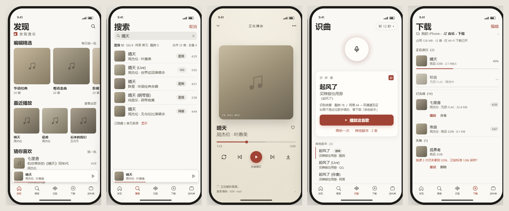
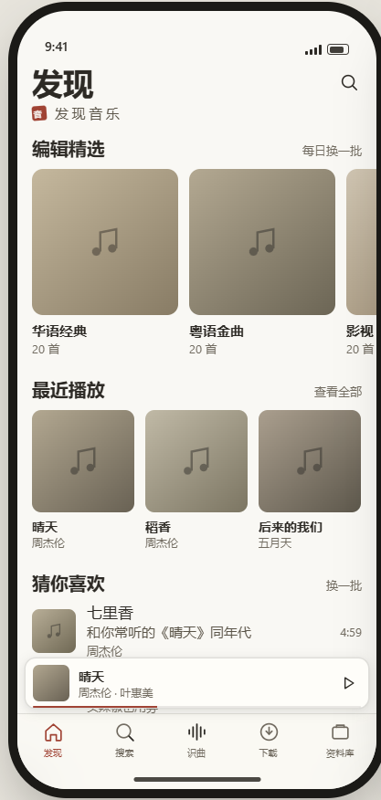
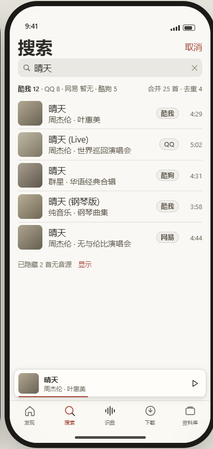
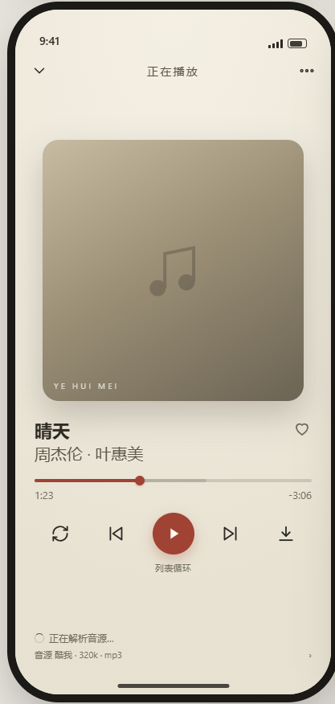
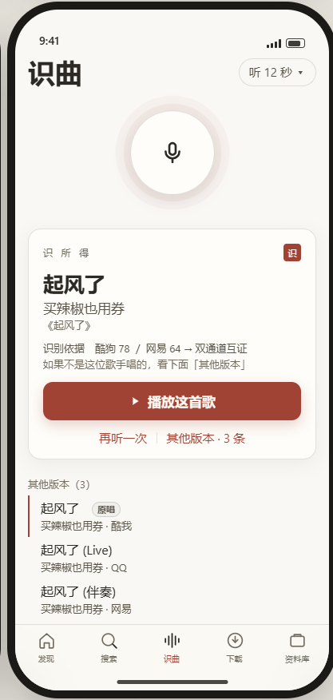
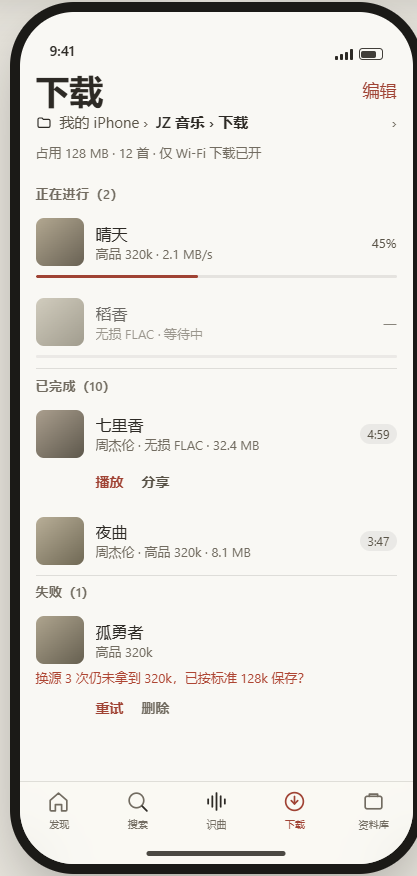

# iOS 版信息架构与逐页设计

> ⚠️ **2026-11-16 起：底部导航由 5 Tab 改为 4 Tab（发现 / 识曲 / 下载 / 资料库），搜索不再是 Tab，
> 入口挪到发现页最上方；播放页由 sheet 改为全屏。**
> **2026-11-16 第四轮再改为 5 Tab：发现 / 我的收藏 / 识曲 / 下载 / 设置**（设置从收藏页右上角
> 齿轮拿出来单独占一格，见 [IOS-PRODUCT-FIXES.md](IOS-PRODUCT-FIXES.md) 第四轮 ③）。
> 以本文 §1 为准的实现已过期，最新口径见
> [IOS-PRODUCT-FIXES.md](IOS-PRODUCT-FIXES.md)（老板真机录屏逐轮整改）。本文其余章节的每页
> 布局/五态/无障碍条目仍然有效，只是"搜索页从哪进""设置从哪进"和"Tab 有几格"这几处按上面两句改。

> 配套：[IOS-UI-DESIGN.md](IOS-UI-DESIGN.md)（令牌与视觉规则）、[IOS-FEATURE-PARITY.md](IOS-FEATURE-PARITY.md)（Android 功能 → iOS 落点）。
> 本文所有页面都按"布局 / 交互 / 五态 / 无障碍 / iPad"五项写全；未写全的页面视为未设计。

## 0 视觉稿（5 张，静态）

> 用 HTML 按 393×852 渲染后截图，仅表达布局与层级；**封面是占位色块**（真实版用平台封面），字体用系统字体近似（真机是 SF Pro / 苹方）。
> 源文件 [mockups/mockups.html](mockups/mockups.html)，可直接用浏览器打开改。



| 页面 | 图 |
|---|---|
| 1 发现 |  |
| 2 搜索 |  |
| 3 播放 |  |
| 4 识曲结果 |  |
| 5 下载 |  |

---

## 1 信息架构：6 个目的地 → 5 个 Tab

Android 版是 **6 格底栏**：首页 / 识曲 / 收藏 / 下载 / 历史 / 设置（`MainTab`）。iOS 的 `TabView` 超过 5 个就会自动折叠成 "更多"，等于从底部导航里消失，所以必须做一次合并。原则是**合并"同一种东西"，不合并"两种任务"**。

| Android | iOS 落点 | 为什么 |
|---|---|---|
| 首页 | **发现**（Tab 1） | 原样迁移（编辑精选 / 最近播放 / 猜你喜欢 / 热门音乐） |
| 识曲 | **识曲**（Tab 3） | 头号差异功能，必须有稳定入口；Shazam 也是独立 Tab |
| 收藏 + 历史 | **资料库**（Tab 5），内部分段「收藏 / 最近播放」，搜索历史挪进搜索页 | 三者都是"我的东西"，Apple Music 的「资料库」正是这个结构 |
| 下载 | **下载**（Tab 4） | 有实时进度、失败重试、文件管理，是独立任务，不塞进资料库 |
| 设置 | **资料库 → 右上 gear**（push） | 设置是低频"工具"，Apple Music 也在资料库右上角；腾出的格子给识曲 |
| （搜索） | **搜索**（Tab 2） | 全 App 第一功能，必须占一格（Apple Music 同为独立搜索 Tab） |

```
┌──────────────────────────────────────────────┐
│                   TabView                    │
│  发现   搜索   识曲   下载   资料库           │
└──────────────────────────────────────────────┘
      │      │      │      │        │
      │      │      │      │        ├── 设置（push）
      │      │      │      │        └── 收藏 / 最近播放（内部分段）
      │      │      │      └── 播放页（push，见 §4）
      │      │      └── 其他版本（push）· 时长档位（Menu）
      │      └── 歌曲操作（context menu）· 音源详情（sheet）
      └── 歌单（push）· 榜单（push）
```

**全局悬浮层**
- **Mini Player**：有当前曲目时，常驻在 Tab 栏之上（`.safeAreaInset(edge: .bottom)`），高 56，`.regularMaterial`，圆角 12，左右 8。点任意处 → 打开播放页；右侧播放/暂停；长按 → 菜单（收藏 / 下载 / 音源）。
- **播放页**：`.sheet`（`.large` detent，可下滑关闭，`interactiveDismissDisabled(false)`）。
- **音源详情 / 下载音质 / 队列**：`.sheet`（`.medium`/`.large`）。
- **提示**：不用自绘 Toast。收藏这类即时反馈用轻触觉 + 按钮状态变化；错误用内联状态行；需要打断的用 `.alert`。

**返回语义**（用系统，不手写拦截）

| Android | iOS |
|---|---|
| 返回键逐层：播放页 → 歌单 → 搜索态 → 回首页 → 退出 | 播放页下滑关闭；歌单/榜单/设置用导航栏 `<` 或左缘右滑；搜索态用搜索栏 `取消`；Tab 内回根用「再点一次当前 Tab」 |
| 离开识曲页自动停采集 | `.onDisappear` 停采集（同语义，但由系统生命周期驱动） |

---

## 2 全局组件（先定义，后面页面直接引用）

### 2.1 歌曲行 `SongRow`（全 App 唯一行样式）

```
┌────────────────────────────────────────────────────────────┐
│ ┌────┐  歌名（.body，单行）                        [酷我] 3:45 │
│ │封面│  歌手 · 专辑（.subheadline 次色，单行）              ♡ │
│ └────┘                                                      │
└────────────────────────────────────────────────────────────┘
```
- 高 60（封面 48 + 上下 6），点击整行即播。
- 平台胶囊：`.footnote .semibold`，`.capsule`，12% 朱砂底 + 墨字（§3.3 令牌文档）。
- 时长 `.footnote .monospacedDigit` `.tertiaryLabel`，定宽 40 右对齐。
- 心形只在"收藏页"常显（因为那是它的主操作）；其他页面收进长按菜单与左滑动作，避免每行都是图标（视觉噪音）。
- 状态：`正在解析` → 行尾 `ProgressView` 替换时长；`无源` → 整行 `.opacity(0.4)` + 行尾「暂无音源」小字，点击不播放而是弹一句 `.alert`（与 Android"隐藏无源歌"不同：iOS 保留可见，避免"我搜到了却没发生任何事"的困惑；底部另给"已隐藏 N 首无音源"的开关，默认关）。

### 2.2 状态行 `StatusLine`（播放/识曲/下载共用）

四种外观，都带图标（不靠色）：
| 类型 | 图标 | 文案示例 |
|---|---|---|
| 进行中 | `ProgressView`（16） | 正在解析音源… |
| 换源 | `arrow.triangle.2.circlepath` | 这首没有可用音源，正在换源…（第 2/3 次） |
| 错误 | `exclamationmark.triangle.fill`（systemOrange） | 取流失败：网络已断开 |
| 提示 | `info.circle`（次色） | 已跳过 2 首无音源歌曲 |

### 2.3 空态 `ContentUnavailableView`

统一用系统组件（图标 + 标题 + 说明 + 可选按钮），不再自绘。文案见各页。

### 2.4 横向卡片 `MediaCard`

```
┌──────────┐
│          │  160×160 封面（圆角 12，连续圆角）
│  封面    │
│          │
└──────────┘
标题（.subheadline .semibold，1 行）
副标题（.caption 次色，1 行）
```
- 卡片最小点击区 = 整卡 + 8pt padding。
- 按压缩放 0.96（`.plain` 按钮的自定义反馈），松手回弹；`Reduce Motion` 下不缩放。

### 2.5 平台状态行（搜索结果顶部）

```
酷我 12 · QQ 8 · 网易 暂无 · 酷狗 5        已合并 25 首，去重 4 首
```
- 有结果 = 次色；无结果 = `暂无` + tertiary；失败 = `超时` + `exclamationmark.triangle.fill`（橙色）。
- 右侧显示合并/去重数量，解释"为什么只有 25 首"（Android 没有这行，属于 iOS 可读性补强）。
- 整行可点 → 弹出各平台耗时与错误详情（`.alert` 或 sheet）。

---

## 3 逐页设计

### 3.1 发现（Tab 1）

**布局（iPhone 竖屏，393×852）**

```
┌──────────────────────────────────────────────┐  ← 状态栏
│ 发现                                   ⌕ ⚙  │  ← 大标题；右侧：搜索（跳搜索 Tab）、设置（可选）
│  [印] 发现音乐                                │  ← 品牌行：8pt 朱砂印章图形 + 题字图片（高 28）
├──────────────────────────────────────────────┤
│ 编辑精选                          每日换一批  │  ← .title3 + 右侧 .footnote 动作
│ ┌────────┐ ┌────────┐ ┌────────┐             │
│ │ 封面   │ │        │ │        │  ← 横向 Carousel（160pt 卡）
│ └────────┘ └────────┘ └────────┘             │
│ 华语经典     粤语金曲     影视 OST            │
│ 20 首        20 首        20 首               │
├──────────────────────────────────────────────┤
│ 最近播放                           查看全部  │
│ ┌──────┐ ┌──────┐ ┌──────┐                   │
│ │ 封面 │ │      │ │      │  ← 112pt 卡 × 8
│ └──────┘ └──────┘ └──────┘                   │
│ 晴天      稻香      后来的我们                │
├──────────────────────────────────────────────┤
│ 猜你喜欢                          换一批     │
│ ────────────────────────────────────────────  │
│ [封面] 七里香            （推荐理由 .footnote）│
│        周杰伦                    ▶            │
│ ────────────────────────────────────────────  │
│ … 共 5 行，3 行一屏不留白                    │
├──────────────────────────────────────────────┤
│ 热门音乐                          查看全部  │
│ 1  [封面] 孤勇者  陈奕迅              3:41    │
│ 2  …                                          │
│ 3  …                                          │
├──────────────────────────────────────────────┤
│            （Mini Player 悬浮，见 §2）         │
└──────────────────────────────────────────────┘
```

**交互**
| 元素 | 行为 |
|---|---|
| 编辑精选卡 | push 歌单页（§3.2）；长按 → 菜单「立即播放整张」 |
| 编辑精选「每日换一批」 | 原地刷新四张卡（`.snappy` + 触觉 `.light`），当天已换过则提示"今天已经换过一批啦"（`.alert`） |
| 最近播放卡 | 以"最近播放"为队列起播该曲，并打开播放页 |
| 猜你喜欢行 | 起播（队列=当前推荐列表） |
| 猜你喜欢「换一批」 | 重新取 5 条（同一请求内不重复） |
| 热门音乐行 | 起播（队列=榜单） |
| 下拉 | `.refreshable` 刷新最近播放/推荐 |
| 右侧 ⌕ | 切到搜索 Tab 并聚焦搜索框（"搜索是 Tab"时这个入口可选，保留便于单手） |

**五态**
| 态 | 表现 |
|---|---|
| 首启（纯新用户） | 「最近播放」「猜你喜欢」隐藏；编辑精选 + 热门音乐照常；底部一张引导卡「多听几首，这里会长出你的推荐」（不可点，仅说明） |
| 加载 | 骨架：`.redacted(reason: .placeholder)` 的画廊 + 3 个行占位；不显示转圈遮罩 |
| 有数据 | 上图布局 |
| 推荐失败 | 「猜你喜欢」区块替换为一行 `StatusLine`：`exclamationmark.triangle` + "推荐暂时取不到，稍后再试" + 「重试」文字按钮（不弹窗） |
| 完全离线 | 顶部内联条 `wifi.exclamationmark` + "当前离线，只显示已缓存内容"；编辑精选显示缓存命中项 |

**无障碍**：品牌行朗读「发现音乐」（印章 `accessibilityHidden`）；Carousel 每卡朗读「华语经典，20 首」；榜单行朗读「第 1 名，孤勇者，陈奕迅，3:41」；`accessibilityRotor` 提供"跳到猜你喜欢/热门音乐"。

**iPad**：保持单列，最大宽 700 居中；编辑精选改为 3 列网格（不横向滚动）；猜你喜欢 2 列。

---

### 3.2 歌单页（push）

```
┌──────────────────────────────────────────────┐
│ ‹ 返回            华语经典                    │  ← 内联标题
├──────────────────────────────────────────────┤
│ ┌────┐  华语经典                              │
│ │大图│  今日精选 20 首 · 点单曲即播            │
│ └────┘  [ 播放全部 ]  ← .borderedProminent   │
├──────────────────────────────────────────────┤
│ 01  歌名                          歌手   3:45 │
│ 02  …                                        │
└──────────────────────────────────────────────┘
```
- 头部用 88pt 封面 + 标题 + 副行 + 「播放全部」（唯一朱砂按钮）。
- 行：`%02d` 序号（`.footnote .monospacedDigit` `.tertiaryLabel`，宽 24）+ 歌名 + 歌手。
- 点单曲：先显示行尾 `ProgressView`（该行禁用）→ 解析 → 起播并打开播放页；**失败**：行尾变 `exclamationmark.triangle.fill`，底部内联 StatusLine「未找到可播放版本」。
- 点「播放全部」：逐首解析，队列=整张歌单（与 Android 一致：先抢第一首，其余后台补）。
- 左滑：收藏；长按：下一首播放 / 下载。
- 空态（歌池为空）：`ContentUnavailableView("这张歌单今天没有内容", systemImage: "music.note.list")` + 「换一张」（跳回发现）。

---

### 3.3 榜单页（push，热门音乐全部 21 首）

单列 21 行，序号 1–21，`ContentUnavailableView` 空态；顶部说明「每日更新 · 按平台热度合并」。行点击起播、队列=榜单。

---

### 3.4 搜索（Tab 2）

**布局**

```
┌──────────────────────────────────────────────┐
│ 搜索                              （取消按钮）│  ← .searchable 常驻（navigationBarDrawer .always）
│ ┌──────────────────────────────────────────┐ │
│ │ ⌕  歌曲、歌手、专辑                       │ │
│ └──────────────────────────────────────────┘ │
├──────────────────────────────────────────────┤
│ 最近搜索                            清空      │
│ [晴天] [周杰伦] [起风了] [孤勇者]  ← 胶囊流   │
├──────────────────────────────────────────────┤
│ （输入中/有结果时，上方整块换成下面内容）      │
│ 酷我 12 · QQ 8 · 网易 暂无 · 酷狗 5           │
├──────────────────────────────────────────────┤
│ [封面] 晴天  周杰伦 · 叶惠美        [酷我] 4:29│
│ [封面] 晴天 (Live)  周杰伦          [QQ]  5:02│
│ …                                            │
│ ────────────────────────────────────────────  │
│ 已隐藏 2 首无音源           显示              │
└──────────────────────────────────────────────┘
```

**交互**
| 元素 | 行为 |
|---|---|
| 搜索框 | `.searchable` + `.submitLabel(.search)`；输入即搜（300ms debounce），不需要点按钮 |
| 取消 | 系统「取消」回到初始态（清空关键词与结果） |
| 最近搜索 chip | 点=填入并搜；长按=删除该条；「清空」= 二次确认（`.confirmationDialog`） |
| 结果行 | 点击=起播 + 打开播放页；长按=菜单（见 3.4.1）；左滑（trailing）= 收藏 / 下载 |
| 「显示」 | 展开被隐藏的无源歌（`.opacity(0.4)` + 行尾「暂无音源」） |
| 搜索中 | 结果区显示骨架（3 行）而非整屏转圈；平台状态行逐家点亮 |
| 无结果 | `ContentUnavailableView("没有找到「晴天」", systemImage: "magnifyingglass", description: "换个关键词，或试试只搜歌名")` |
| 平台全失败 | 状态行变橙色说明 + 结果区 `ContentUnavailableView("搜索暂时不可用", ... )` + 「重试」 |

**3.4.1 歌曲长按菜单（iOS 的"动作中心"，替代 Android 的每行爱心+胶囊）**

```
播放
下一首播放
──────────
收藏                     ♡
下载…（音质）
──────────
查看音源                 ›
复制歌曲信息
分享                     ↗
```
- 每个动作给触觉 `.light`；「收藏」成功后菜单关闭 + 行内心形短暂出现（**不弹 Toast**）。
- 「查看音源」→ 音源详情 sheet（§3.5）。
- 「分享」用系统 `ShareLink`（分享文本「歌名 - 歌手」，不含直链，避免版权风险落点）。

**五态**：首屏（最近搜索 / 无记录时的引导「搜一次，四家一起找」）/ 输入中 / 有结果 / 无结果 / 平台失败。

**无障碍**：结果行合并朗读；「已隐藏 N 首无音源，显示」按钮有明确 label；搜索框 `textContentType` 不设（非个人信息）。

---

### 3.5 音源详情（Sheet，medium/large）

把 Android 藏在播放页角落的一行小字（`音源：后端 · 档位 · 容器 · ID 直连`）做成一个可读的页面——这是本产品最"别人没有"的技术透明度，值得给一个界面。

```
┌──────────────────────────────────────────────┐
│              音源详情                    ✕    │
│ 晴天 / 周杰伦                                 │
├──────────────────────────────────────────────┤
│ 当前播放                                      │
│ ✓ 真实 320k · mp3 · 酷我官方（ID 直连）  4:29 │
│   已校验：头部 mp3，体积 7.5 MB → 318 kbps     │
├──────────────────────────────────────────────┤
│ 这条音源怎么来的                              │
│ 1  本平台取流     ✓ 酷我                     │
│ 2  跨平台补源     — 未使用                    │
│ 3  通用兜底       — 未使用                    │
├──────────────────────────────────────────────┤
│ 其他可用音源（2）                             │
│ · 无损 FLAC · QQ（按 ID 直连）      5.8:1?    │
│ · 128k mp3 · 网易                    ✔ 校验  │
├──────────────────────────────────────────────┤
│ 歌词：LDDC · 逐字（酷狗 KRC）  42 行          │
│ [ 重新解析音源 ]                              │
└──────────────────────────────────────────────┘
```
- 只读信息 + 一个「重新解析」按钮（内部强制绕过缓存、重跑三级链路）。
- 灰度说明：不暴露接口 URL（设计上禁止把直链显示在界面上）。
- 无障碍：三段各自组合朗读；`✓`/`—` 必须配文字。

---

### 3.6 播放页（Sheet，`fullScreenCover` 观感）

**竖屏布局**

```
┌──────────────────────────────────────────────┐
│        ⌄                          ⋯          │  ← 下滑关闭（系统）+ 更多菜单
│              正在播放                         │
├──────────────────────────────────────────────┤
│                                              │
│        ┌────────────────────────┐            │
│        │                        │            │
│        │        封 面            │  ← 20 圆角，宽 82%，投影 24/0.18
│        │                        │            │
│        └────────────────────────┘            │
│              （点封面 → 歌词）                │
│                                              │
├──────────────────────────────────────────────┤
│ 晴天                                    ♡    │  ← .title2 .bold / heart .title3
│ 周杰伦 · 叶惠美                              │
├──────────────────────────────────────────────┤
│ ●━━━━━━━━━━━━━╸───────────────              │  ← 已播朱砂，缓冲 20% 墨
│ 1:23                                     4:29│
├──────────────────────────────────────────────┤
│   ⟳        ⏮     ▶︎     ⏭        ↓          │
│  列表循环                                   │
├──────────────────────────────────────────────┤
│ 正在解析音源…（StatusLine，固定 20pt 高）     │
│ 音源 酷我 · 320k · mp3              ›        │
└──────────────────────────────────────────────┘
```

**交互**
| 元素 | 行为 |
|---|---|
| 下滑 | 关闭播放页（系统 sheet 手势，不做自定义） |
| ⋯ | 菜单：**歌词 / 封面**、**播放队列**、**锁屏歌词**（开/关）、**识曲**（跳识曲 Tab 并自动开录）、**重新解析音源** |
| 封面 | 单击 = 切歌词（**不是双击**：iOS 无双击惯例，双击会让 VoiceOver 用户永远学不会）；带 `.contentShape` 全覆盖 |
| 歌词 | 单击行 = seek 到该行；长按 = 复制全文；底部有「返回封面」明确按钮（不只靠点） |
| 收藏 ♡ | 触觉 `.light` + `.bouncy` 缩放；无 Toast |
| 进度条 | 按下即预览（时间标签跟随）、拖动实时、松手 seek；拖动中暂停自动滚动歌词 |
| 循环 | 点=循环切换三态（单曲循环 → 列表循环 → 随机），图标切换 + `.light`；状态用**文字**显示在按钮下方（`.caption`），不只靠图标 |
| 下载 ↓ | 打开音质 sheet（§3.7） |
| 音源行 | 打开音源详情 sheet（§3.5） |
| AirPlay | 系统 route picker 出现在状态行右侧（有外部路由可用时） |

**歌词态（同页替换封面）**

```
│  ┌──────────────────────────────────────────┐│
│  │        忽然    就    想    起             ││  ← 当前行 .title2 bold 朱砂，逐字填充
│  │                                          ││
│  │   你 的 脸 庞                            ││  ← 非当前行 .body 次色 55%
│  │                                          ││
│  │   在 我 脑 海 里                          ││
│  │                                          ││
│  └──────────────────────────────────────────┘│
```
- 当前行居中，上下各留半屏空白；自动滚动用 `.scrollPosition` + spring，不手写偏移。
- 逐字：每字自己的 start/end 染色；没有逐字时间时按行内均分插值（与 Android 同一口径）。
- 无歌词三态：「歌词加载中…」（骨架）/「暂无歌词」+ 说明来源 / 「歌词来源不支持逐字」。
- 字号：`.title2` 起，随 Dynamic Type 放大；播放页歌词区不提供字号调节（遵循系统设置），**与 Android 一致（Android 也不可调）**。

**五态**：解析中 / 播放中 / 暂停 / 无源（三级重试中）/ 播放失败（含"时长不符已拒绝"的具体原因文案，逐字照搬 Android 的透明口径）。

**iPad / 横屏**：左 46% 封面或歌词，右 54% 题名 → 进度 → 控件 → 状态 → 音源（沿用 Android 横屏的权重分配，改成 SwiftUI `HStack` + `ViewThatFits`）。

---

### 3.7 下载音质 Sheet（`.medium`）

```
┌──────────────────────────────────────────────┐
│ 下载歌曲                                  ✕   │
│ 晴天 · 周杰伦                                 │
├──────────────────────────────────────────────┤
│  ┌────────┐ ┌────────┐ ┌────────┐            │
│  │ 标准   │ │ 高品   │ │ 无损   │  ← 三选一（默认=设置里的默认音质）
│  │ 128k   │ │ 320k   │ │ FLAC   │            │
│  └────────┘ └────────┘ └────────┘            │
│ 拿不到所选档位会自动换源，每条都按文件体积     │
│ 核实真实码率；仍然没有就按可得的最高档保存。   │
├──────────────────────────────────────────────┤
│              [ 开始下载 ]                     │
└──────────────────────────────────────────────┘
```
- 三选一用 `.segmented` 观感的三个卡片（可点，选中朱砂描边 + 勾）；也可用原生 `Picker(.segmented)`——**落码建议用原生 segmented**，卡片只是视觉稿。
- 下载中：按钮变禁用 + `ProgressView` + 「正在解析音源…」；遮罩可点关闭只在未开始时允许。
- 失败：sheet 内联错误 + 「重试」。

---

### 3.8 识曲（Tab 3）

**布局（准备/聆听/辨认态）**

```
┌──────────────────────────────────────────────┐
│ 识曲                          听 12 秒 ▾      │  ← 大标题 + 右上 Menu（12/15/20 秒）
├──────────────────────────────────────────────┤
│                                              │
│                 ╭──────╮                     │
│                 │  🎤  │   ← 146pt 圆形舞台，随实时响度缩放
│                 ╰──────╯                     │
│                                              │
│              点一下麦克风，开始听              │  ← .title3
│           把手机靠近正在外放的音箱             │  ← .subheadline 次色
│                                              │
├──────────────────────────────────────────────┤
│ 第一次用？                                    │
│ · 外放不用开到最大，正常音量就够               │
│ · 一米内，别用手挡住麦克风                     │
│ · 环境太吵就换个地方                           │
├──────────────────────────────────────────────┤
│ 最近识过                          点一条直接播放│
│ 起风了                          买辣椒也用券   │
│ …（贴底排列）                                 │
└──────────────────────────────────────────────┘
```

**状态机（与 Android 完全对齐）**
| 阶段 | 文案 | 麦克风 |
|---|---|---|
| 准备 | 点一下麦克风，开始听 | 可点，`.medium` 触觉 |
| 聆听 | 正在聆听… / 还能听 N 秒 / 再点一下可取消 | 可点=取消（`stop.fill` 覆盖） |
| 辨认 | 正在辨认… / 比对曲库中 | 可点=取消 |
| 结果 | 显示结果卡（下） | 缩小 0.72，可点=重听 |
| 无权限 | 「没拿到麦克风权限」+ 说明 + 「去设置」 | 不可点 |
| 没听清（音量不足） | 「没听清」+ 具体 dB 说明 + 「再听一次」 | 可点 |
| 失败 | 「识别失败」+ 原因 + 「再试一次」 | 可点 |

**结果态**

```
┌──────────────────────────────────────────────┐
│ 识所得                              [印]      │
│                                              │
│ 起风了                                        │  ← .title .bold
│ 买辣椒也用券                                  │
│ 《起风了》                                    │
│                                              │
│ 识别依据  酷狗 78 ／ 网易 64 → 双通道互证      │  ← .footnote 次色
│ 如果不是这位歌手唱的，看下面「其他版本」        │
│                                              │
│  ┌────────────────────────────────────────┐  │
│  │            ▶ 播放这首歌                │  │  ← 唯一实心朱砂按钮
│  └────────────────────────────────────────┘  │
│        再听一次   |   其他版本 · 3 条          │
├──────────────────────────────────────────────┤
│ 其他版本（3）                                 │
│ ┌ 起风了        原唱  买辣椒也用券 · 酷我     │  ← 左侧 2pt 朱砂细签=原唱
│ │ 起风了 (Live)        买辣椒也用券 · QQ      │
│ └ 起风了 (伴奏)        买辣椒也用券 · 网易    │
└──────────────────────────────────────────────┘
```
- 「原唱」用文字小胶囊（不是颜色）。
- 「识别依据」是产品差异点，**必须**显示（Android 有）；分数照实显示。
- 主按钮在 `noExact`（识别到变体版）时变「看看其他版本」，并给一行说明原因。
- 起播中：主按钮禁用 + `ProgressView` + 「正在起播…」；「再听一次」变「再听一次（会中断起播）」。
- 「最近识过」最多 50 条，持久化，贴底排列（与 Android 一致），空态用三件小事引导。

**权限（设计好的"先解释再申请"）**
1. 首次点麦克风 → 应用内解释卡（半屏 sheet，非系统框）：「识曲需要麦克风，只采环境音、不保存不上传」+ 「允许」/「先不用」。
2. 点「允许」→ 系统框。
3. 拒绝过 → 结果区直接显示「没拿到麦克风权限」+ 「去设置」（`UIApplication.openSettingsURLString`），不再重复申请。
- `Info.plist`：`NSMicrophoneUsageDescription` = 「识别你正在听的歌时需要使用麦克风，只采集几秒环境音，录音不会保存，也不会上传。」

**其它**
- 进页面**不**自动采集（Android 只在从播放页菜单跳入时自动开录；iOS 保持：仅当由播放页「识曲」进入时自动开录，且用系统麦克风指示器可见）。
- 识别前自动暂停本机播放（Android 有 `holdPlayback` 闸门）；iOS 同样暂停并在结果后询问「继续播放上一首？」（`alert`，仅当原本在播）。

---

### 3.9 下载（Tab 4）

```
┌──────────────────────────────────────────────┐
│ 下载                            [编辑]        │
├──────────────────────────────────────────────┤
│ 保存位置  我的 iPhone › JZ音乐 › 下载   ›     │  ← 点=打开 Files 定位
│ 占用 128 MB · 12 首 · 仅 Wi-Fi 下载 开         │
├──────────────────────────────────────────────┤
│ 正在进行（2）                                 │
│ ▓▓▓▓▓▓░░░░  晴天 · 320k        2.1 MB/s  45% │
│ ▓▓░░░░░░░░  稻香 · 无损        等待中         │
├──────────────────────────────────────────────┤
│ 已完成（10）                                  │
│ [封面] 七里香 · 无损 · 32.4 MB        4:59    │
│        周杰伦 · 已保存                        │
│        [播放]  [分享]  ← 点行展开的操作区     │
├──────────────────────────────────────────────┤
│ 失败（1）                                     │
│ [封面] 孤勇者 · 320k    换源 3 次仍无符合档位  │
│        [重试]  [删除]                         │
└──────────────────────────────────────────────┘
```
- 分组：正在进行 / 已完成 / 失败（Android 是单列表，iOS 分组更易扫读）。
- 行内进度：4pt 进度条 + 百分比（等宽数字）；总字节未知时显示已下载字节。
- 左滑：删除（含文件）/ 重试（仅失败）；「编辑」进入多选，批量删除。
- 行点击：**播放本地文件**（iOS 有 Files 沙盒，能真放本地；Android 版点下载行是走在线取流，这里更合理，标注为"改进"）。
- 「分享」= `ShareLink` 导出文件到其他 App。
- 空态：`ContentUnavailableView("还没有下载任务", systemImage: "arrow.down.circle", description: "在播放页点「下载」，选一个音质")`。
- 无网络时：顶部内联条「离线，下载已暂停」。

---

### 3.10 资料库（Tab 5）

```
┌──────────────────────────────────────────────┐
│ 资料库                                  ⚙    │  ← gear → 设置
├──────────────────────────────────────────────┤
│         [ 收藏 ][ 最近播放 ]                  │  ← 系统 Picker(.segmented)
├──────────────────────────────────────────────┤
│ ┌────┐ 我喜欢的音乐                           │
│ │拼贴│ 28 首 · 收藏即得                        │
│ └────┘ [ 播放全部 ]  [ 随机播放 ]             │
├──────────────────────────────────────────────┤
│ [封面] 晴天  周杰伦 · 叶惠美       [酷我] ♥   │
│ …                                            │
└──────────────────────────────────────────────┘
```
- 头图：4 格封面拼贴（无封面时用纸色 + 音符）。
- 收藏空态：`ContentUnavailableView("还没有收藏的歌曲", systemImage: "heart", description: "在歌曲上左滑或长按就能收藏")` + 「去搜索」（切 Tab）。
- 「最近播放」分段：最多 50 条，行样式相同，副行右侧显示相对时间（「今天」「昨天」「3 天前」）。
- 行左滑：取消收藏（收藏）/ 下一首播放；长按：完整菜单。
- 「播放全部」= 队列为收藏列表；「随机播放」= 队列为收藏并切到随机模式（会同步播放页的循环按钮状态）。
- 编辑排序：点「编辑」可拖动排序收藏（Android 没有；iOS 用户预期，标为新增）。

---

### 3.11 设置（push，`Form`）

```
设置
├─ 外观
│   跟随系统 / 浅色 / 深色          （.picker .segmented 或 inline）
├─ 播放
│   音质偏好            标准 128k / 高品 320k / 无损 FLAC
│   无源自动换源        开
│   跨平台补源          开
│   无源自动跳过        开
│   连续跳过上限        3 首
├─ 歌词
│   逐字歌词            开
│   锁屏歌词（实时活动） 关
│   歌词字号            跟随系统 / 大 / 特大
├─ 识曲
│   聆听时长            12 / 15 / 20 秒
│   识别前暂停本机播放   开
├─ 下载
│   默认音质            高品 320k
│   仅 Wi-Fi 下载       开
│   后台下载            开
│   已下载              12 首 · 128 MB  ›
├─ 数据
│   清空搜索历史                        20 条
│   清空最近播放                        50 条
│   清空识曲历史                        8 条
│   清理缓存                            46 MB
├─ 权限
│   麦克风              已允许  ›
│   通知                未请求  ›
├─ 关于
│   版本                2.2.0 (1)
│   更新日志            ›
│   免责声明与版权说明  ›
│   隐私政策            ›
│   开源许可            ›
│   诊断日志            ›（分享）
```

**规则**
- 用 `Form` + `Section`，标题用系统分组头；开关用原生 `Toggle`（tint 朱砂）；单选用 `Picker`。
- 破坏性操作（清空）用 `.destructive` 红字 + `.confirmationDialog` 二次确认，并在确认文案里给出数量（「清空 20 条搜索历史？」）。
- 设置项与 Android 的 key 一一对应，映射表见 [IOS-FEATURE-PARITY.md](IOS-FEATURE-PARITY.md) §6。
- 「锁屏歌词」需要 Live Activity，首次开启时解释「会在锁屏和灵动岛显示正在播放的歌词，可在设置里随时关」。

### 3.12 播放队列（Sheet，iOS 新增但暴露内部已有能力）

```
┌──────────────────────────────────────────────┐
│ 正在播放                      清空  ✕         │
│ 队列 12 首 · 还有 43 分钟                      │
├──────────────────────────────────────────────┤
│ ▸ [封面] 晴天        周杰伦          ⠿        │  ← 拖拽把手（编辑态）
│   [封面] 稻香        周杰伦                   │
│   …                                          │
│ ────────────────────────────────────────────  │
│ 接下来自动补位（跨平台补源中）…                │
└──────────────────────────────────────────────┘
```
- 拖拽排序、左滑移除、点行跳到该曲。
- 「清空」只清后续、保留当前曲。
- Android 没有队列页 → 标为 iOS 新增（补齐 iOS 用户预期）。

---

## 4 跨设备与系统界面

### 4.1 iPad

| 区域 | 设计 |
|---|---|
| 主结构 | iPhone 的 5 Tab 保留（iOS 18 的 TabView 在 iPad 顶部显示为浮动 Tab 栏）；不做 `NavigationSplitView`，因为产品只有 5 个平级目的地，侧栏反而多一层 |
| 发现 | 3 列网格（编辑精选）、猜你喜欢 2 列 |
| 播放页 | `HStack`：左 46% 封面（或歌词）/ 右 54% 题名+控件+音源；尺寸类为 regular 时不再用 sheet，而是右侧常驻面板（`NavigationSplitView` detail 或悬浮播放条） |
| 横屏 | 与 iPad 同构（Android 的横屏版式直接沿用权重） |
| 键盘 | ⌘F 搜索、空格 播放/暂停、←/→ 上一首/下一首、⌘L 歌词、⌘↓ 下载 |

### 4.2 锁屏 / 灵动岛 / 控制中心（iOS 的"桌面歌词"答案）

详见 [IOS-FEATURE-PARITY.md](IOS-FEATURE-PARITY.md) §4，视觉规格：

| 表面 | 内容 |
|---|---|
| 锁屏（Now Playing） | 封面 + 歌名 + 歌手 + 进度 + 上一/播放/下一 + **当前歌词一行**（可关） |
| 灵动岛 · 紧凑 | 左侧封面圆图 + 右侧 3 条跳动波形（播放中）/ 暂停图标 |
| 灵动岛 · 展开 | 封面 + 歌名 + 当前歌词行 + 进度细线 + 上一/播放/下一 |
| 锁屏 Live Activity 卡片 | 封面 + 歌名/歌手 + 当前行歌词（逐字填充）+ 进度 + 控制 |
| 控制中心 | 系统「正在播放」模块（自动获得）+ 自定义控制「识曲」 |
| 耳机 / AirPods | 单击播放暂停、双击下一首、长按 Siri（系统 `MPRemoteCommandCenter`，全自动） |

### 4.3 Widget（主屏/锁屏小组件）

| 尺寸 | 内容 |
|---|---|
| 小（2×2） | 当前曲目封面 + 播放/暂停 |
| 中（4×2） | 封面 + 歌名 + 歌手 + 最近 3 首收藏 |
| 锁屏圆形 | 一键识曲 |
| 锁屏矩形 | 当前歌词一行 |

### 4.4 Siri / 快捷指令 / 聚焦

- App Intents：`识别正在播放的歌`、`播放我的收藏`、`播放最近播放`、`搜索歌曲（query）`。
- 支持 `AppShortcuts`（"用 JZ 音乐识曲"），可在控制中心/操作按钮绑定。
- 聚焦索引：收藏与最近播放的歌曲（`CSSearchableIndex`），点搜索结果直接播。

---

## 5 页面清单与优先级

| # | 页面 | 类型 | 优先级 | 依赖 |
|---|---|---|---|---|
| 1 | 发现 | Tab | P0 | 首页数据源 |
| 2 | 搜索 + 结果 | Tab | P0 | 四平台适配器 |
| 3 | 播放页（含歌词/队列/音源） | Sheet | P0 | 取流/歌词/AudioSession |
| 4 | Mini Player | 全局 | P0 | 播放状态 |
| 5 | 下载 + 音质 sheet | Tab | P0 | 后台下载/校验 |
| 6 | 资料库（收藏/最近） | Tab | P0 | 本地存储 |
| 7 | 设置 | push | P1 | 偏好存储 |
| 8 | 识曲 + 结果 | Tab | P1 | 麦克风/指纹引擎 |
| 9 | 歌单 / 榜单 | push | P1 | 编辑精选数据 |
| 10 | 音源详情 | Sheet | P2 | 三级解析链路暴露 |
| 11 | 锁屏歌词 / 灵动岛 | 系统 | P2 | ActivityKit |
| 12 | Widget / App Intents | 系统 | P3 | AppIntents |
